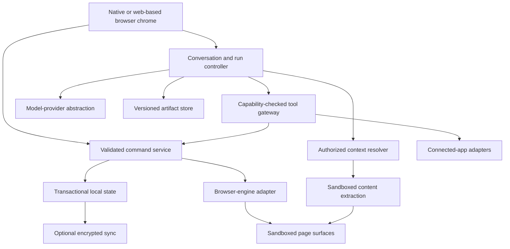

# Arc and Dia: feature inventory and rebuild specification

Research date: **7 November 2026**. Scope: Arc desktop, Arc Search mobile, Dia desktop, significant historical features, and the browser foundations needed to make them work.

This guide contains **116 entries**: **40 Arc desktop**, **50 Dia**, **10 mobile**, and **16 shared engineering foundations**. An entry may group tightly related controls rather than count every menu item as a separate feature. It is a broad implementation specification, not a claim that every hidden experiment, operating-system API, or undocumented setting has been discovered.

The short **Documented evidence** paragraph in each entry states what the cited source establishes. Everything under **Rebuild contract**, **State and storage**, **Implementation**, and **Acceptance tests** is an independently proposed implementation specification. It is not recovered Arc/Dia source code and should not be described as their actual internal architecture. An agent can implement these contracts; exact behavioral or visual parity still requires version-matched observation where an entry lists open questions.

Two items deliberately remain discovery tasks: **A39 TypeTravel**, whose name appears in official material without a usable behavior description, and **M03 pinch-to-summarize**, whose gesture was not verified in the reviewed current documentation. Do not turn those gaps into confident product claims.

## Read this before selecting a target

Arc’s published timeline says desktop Arc stops working on **22 December 2026**, with mobile AI and sync switching off on **23 November 2026**. Its iOS browser continues in a reduced form. Treat the Arc entries as features to preserve independently rather than integrations that can rely indefinitely on Arc’s hosted services. [Official timeline](https://resources.arc.net/hc/en-us/articles/44412972248471-Arc-Sunset-Key-Dates-and-What-to-Expect).

Several historical features should not be mistaken for current ones: Arc Notes was deprecated on **18 April 2024**; Arc’s macOS Ask on Page was removed on **28 August 2025**; Dia began retiring saved Memory on **24 September 2026**. Historical entries remain included because rebuilding the combined feature set may be more useful than copying only today’s product. [Arc release history](https://resources.arc.net/hc/en-us/articles/20498293324823-Arc-for-macOS-2024-2026-Release-Notes), [Dia Memory transition](https://www.diabrowser.com/changelog/mac/1-50-0).

Public documentation has inconsistencies. The Arc migration FAQ says Dia lacks automatic link routing, but Dia’s **5 November 2026** macOS release explicitly adds incoming-URL rules. This guide treats the dated, specific release as evidence for the newer capability. The security page and home-page visuals still describe Memory, while a later release announces its retirement. Current Memory behavior must therefore be checked against the actual build. [Migration FAQ](https://resources.arc.net/hc/en-us/articles/44413577819159-Arc-Sunset-Frequently-Asked-Questions), [Dia 1.56.0](https://www.diabrowser.com/changelog/mac/1-56-0), [Dia security](https://www.diabrowser.com/security).

Local read-only bundle inspection found **Arc 1.133.0, build 74573**, and **Dia 1.56.0, build 90312** installed on this computer. Their bundle inventories include `ArcCore.framework`; Dia also contains libraries named `libAIInfra` and `libContentConversion`. These names establish file presence only. They do not prove how any feature executes. See `local-evidence.json` in this pack for the metadata and plist hashes. No browser-profile databases, cookies, saved credentials, or personal browsing content were read. A native-UI inspection attempt timed out; this is not a UI-verified or pixel-measured report. REA’s documentation was reviewed, but REA was not installed or executed.

Choose one explicit target:

| Target | Meaning |
|---|---|
| Arc preservation | Rebuild the selected historical Arc desktop/mobile behavior independently of discontinued services. |
| Current Dia parity | Match a dated Dia build and its platform capabilities; exclude retired Memory unless intentionally retained. |
| Combined browser | Use Arc organization and creative tools plus Dia contextual AI; document decisions where behaviors conflict. |

The proposed default is a **combined desktop browser**, with macOS first, Windows next, and mobile as a separate phase. This is a recommendation for sequencing, not an inferred user platform preference.

## Product model: concepts that must stay distinct

| Concept | Owns | Does not automatically own |
|---|---|---|
| Storage group | Cookies, site storage, cache, credential references, engine permissions | Tab layout or AI access to every document |
| Workspace | Tab organization, theme, selection, saved groups | A unique login identity |
| Saved tab | Home URL, label, icon, position, durable membership | A permanently running renderer |
| Live tab | Current navigation and runtime surface | Permanent pin membership |
| Folder | Ordered hierarchical organization | A live background task |
| Tab Group | A flat collection of tabs and saved members | Nested folders in Dia-compatible mode |
| Split | A layout of independent page surfaces | A single merged navigation history |
| Conversation | Messages, referenced snapshots, artifacts, run history | Unlimited access to open tabs |
| Context snapshot | Content read at a particular document revision/time | A continuously changing page |
| Skill | Versioned reusable instructions and requested capabilities | Preapproval for external effects |
| Connector | An authorized provider account/workspace | Every account logged into the browser |

Arc’s Space-to-Profile migration into Dia is the reason a clone needs both **workspace identity** and **storage-group identity**. Do not use a single `profileId` as a substitute for both. Keep AI retrieval permissions independently scoped. [Migration behavior](https://resources.arc.net/hc/en-us/articles/44413129117591-Move-from-Arc-to-Dia).

## Suggested architecture

The following architecture is proposed, not a reverse-engineering finding.



### Engine choice is a product decision

| Approach | Good fit | Material limitation |
|---|---|---|
| Maintained Chromium-derived browser | Production browser with broad extension and browser API compatibility | Large upstream maintenance, packaging, and security workload |
| Electron with `WebContentsView` | Fast desktop prototype with real web pages, tabs, and splits | Supports only a subset of Chrome extension APIs; arbitrary store compatibility is not promised |
| Native mobile shell with an engine adapter | Touch UI, lifecycle, native sharing, mobile permissions | Separate platform integration and feature validation are necessary |

Electron documents native views that host web contents and explicitly limits extension compatibility. A web application with ordinary iframes cannot be treated as a full browser substitute: arbitrary sites, storage isolation, permissions, downloads, and process ownership need engine-level support. [WebContentsView](https://www.electronjs.org/docs/latest/api/web-contents-view), [extension limitations](https://www.electronjs.org/docs/latest/api/extensions). Chromium’s process separation is the baseline for the production security model. [Chromium architecture](https://www.chromium.org/developers/design-documents/multi-process-architecture/).

A suggested prototype implementation uses TypeScript for the domain layer and UI, a transactional SQLite store, an Electron engine adapter, and provider-neutral AI/connector interfaces. A production Chromium fork can reuse the domain contracts but will require a different engine adapter and substantial native work. Neither choice recreates proprietary cloud services automatically.

### Minimum data contracts

```ts
type ID = string;
type Revision = number;

interface Workspace {
  id: ID;
  storageGroupId: ID;
  aiScopeId: ID;
  name: string;
  themeId: ID;
  selectedTabId?: ID;
  orderKey: string;
  revision: Revision;
}

interface SavedTab {
  id: ID;
  workspaceId?: ID;
  storageGroupId: ID;
  kind: 'favorite' | 'pin' | 'group-member';
  homeUrl: string;
  titleOverride?: string;
  iconOverride?: string;
  folderId?: ID;
  groupId?: ID;
  orderKey: string;
  revision: Revision;
}

interface Tab {
  id: ID;
  workspaceId: ID;
  savedTabId?: ID;
  currentUrl: string;
  title: string;
  lifecycle: 'unloaded' | 'loading' | 'live' | 'discarded' | 'archived';
  lastActivatedAt: string;
  navigationRevision: Revision;
  revision: Revision;
}

type SplitNode =
  | { kind: 'leaf'; paneId: ID; tabId: ID }
  | { kind: 'branch'; axis: 'horizontal' | 'vertical'; ratio: number;
      first: SplitNode; second: SplitNode };

interface ContextSnapshot {
  id: ID;
  sourceId: ID;
  documentRevision: string;
  capturedAt: string;
  aiScopeId: ID;
  contentHash: string;
  coverage: 'complete-for-request' | 'partial' | 'unavailable';
  blocks: Array<{ id: ID; kind: string; text?: string; location: unknown }>;
  failures: Array<{ code: string; explanation: string }>;
}

interface ActionPlan {
  id: ID;
  runId: ID;
  toolId: ID;
  accountId?: ID;
  targetResourceIds: ID[];
  expectedRevisions: Record<ID, Revision>;
  effect: 'read' | 'local-reversible' | 'external-write';
  payload: unknown;
  approvedPayloadHash?: string;
  idempotencyKey: string;
}
```

Add tables for folders, groups, windows, history, bookmarks, archive entries, connections, conversations, messages, tools, artifacts, assets, skills, preferences, sync operations, and deletion tombstones. Use foreign-key constraints and schema migrations. Do not store runtime process handles, live media tracks, or authentication tokens in ordinary synced entity records.

Important invariants:

1. Every live tab belongs to exactly one workspace and a compatible storage group.
2. A saved tab can exist without a live renderer.
3. A live page can have only one presentation owner unless the engine explicitly supports a different arrangement.
4. A folder cannot contain itself or any ancestor.
5. A Dia-compatible group cannot contain another group; an Arc folder can contain folders.
6. A split leaf points to a valid tab in an allowed browsing context.
7. Deletion must remove or invalidate derived search records, cached AI context, and eligible synced copies.
8. A model cannot manufacture a valid tab ID, source citation, connector permission, or approved action.
9. Provider account IDs and workspace/tenant IDs are part of cache identity.
10. The UI cannot claim success before the authoritative state or remote action outcome confirms it.

### Explicit state transitions

| Event | Required transition |
|---|---|
| Open saved pin | Keep saved record; create/activate runtime tab; load its home/current URL according to policy |
| Close loaded pin | Release runtime page; retain saved record and placement |
| Remove pin | Remove saved membership; explicitly decide whether the live tab remains temporary |
| Archive temporary tab | Persist recovery snapshot; mark archived; release renderer |
| Restore archived tab | Create/reactivate a valid tab and destination; preserve archive provenance |
| Promote Peek | Transfer live surface/history to durable tab or split; remove overlay ownership |
| Move to another storage group | Reopen destination navigation in the new context; do not move authenticated runtime state |
| Close pinned group | Retain saved members while unloading contents according to selected target behavior |
| Dissolve group | Remove group container while preserving its tabs |
| Submit chat | Freeze context references; resolve permissions; create run and source registry |
| Stop AI run | Stop new work; settle or report in-flight tool outcomes; keep completed results |
| Edit approved draft | Invalidate approval for the old payload; require review of the new concrete content |

### Interfaces that prevent feature-by-feature duplication

```ts
interface BrowserCommands {
  execute(command: BrowserCommand, expectedRevision?: number): Promise<CommandResult>;
  undo(transactionId: string): Promise<CommandResult>;
}

interface EngineAdapter {
  createSurface(storageGroupId: string): Promise<SurfaceHandle>;
  navigate(surfaceId: string, url: string, disposition: NavigationDisposition): Promise<void>;
  moveSurface(surfaceId: string, hostId: string): Promise<void>;
  capture(surfaceId: string, request: CaptureRequest): Promise<AssetRef>;
  discard(surfaceId: string): Promise<void>;
}

interface ContextResolver {
  resolve(refs: ContextRef[], grant: ReadGrant, budget: ContextBudget): Promise<ContextSnapshot[]>;
}

interface ToolGateway {
  plan(request: ToolRequest, scope: RunScope): Promise<ActionPlan>;
  execute(plan: ActionPlan, grant: CapabilityGrant): Promise<ToolResult>;
}
```

`BrowserCommand`, `ToolRequest`, and every result need discriminated unions or equivalent runtime schemas. UI buttons, keyboard shortcuts, imported data transformations, and AI tab tools must use the same command handlers. Arbitrary model text must never become a shell command, SQL statement, JavaScript evaluation, or privileged IPC method.

### AI data path

1. Resolve explicit user context and the currently authorized implicit page context.
2. Take snapshots with document identity, time, and coverage.
3. Extract and normalize in a constrained process.
4. Remove disallowed fields and apply origin/profile/organization policies.
5. Retrieve only the blocks needed for the request, with source IDs.
6. Run the model through a provider abstraction with a bounded tool set.
7. Validate structured outputs and citations.
8. For a write, create a concrete plan and revalidate its target and reviewed payload before execution.
9. Stream safe presentation blocks; persist completed artifacts and tool receipts.
10. On deletion, invalidate the source’s derived retrieval and cached context.

Recommended action classes are `read`, `local-reversible`, and `external-write`. Closing recoverable temporary tabs can have a different review policy from sending an email. The implementation must record the policy and its enforcement; do not put all responsibility into a prompt.

### Performance and quality budgets

These are suggested initial targets, not measured Arc/Dia benchmarks:

| Interaction | Initial target on a declared reference machine |
|---|---|
| Local command-bar results | p95 under 100 ms for 10,000 local records |
| Select an already-loaded tab | p95 under 100 ms excluding page-specific rendering |
| Local save/pin/group command | Visual acknowledgment within 100 ms; durable commit tracked |
| Sidebar scrolling | No repeated main-thread stalls over 50 ms in a 1,000-row fixture |
| AI request | Immediate progress/cancel UI; measure extraction, model, and tool latency separately |
| Startup | Restore chrome and selected tab before loading inactive background pages |
| Resource use | Bound favicon, thumbnail, page-snapshot, and model-response caches |

Protect active calls, capture, downloads, and dirty editors from inappropriate discarding. Lazy loading and saved metadata must not imply that every pinned site consumes a renderer. Back/forward cache, background throttling, and discard eligibility should remain coordinated with the engine.

## Feature index

The numbered entries below are the handoff units. Their acceptance tests are **test specifications**, not claims that implementations or reference applications were tested successfully.

### Arc desktop — 40 entries

| ID | Feature | Status |
|---|---|---|
| [A01](#a01) | Vertical sidebar and focus behavior | documented |
| [A02](#a02) | Spaces and switching contexts | documented |
| [A03](#a03) | Profiles and separate browsing data | documented |
| [A04](#a04) | Favorites as persistent icon tabs | documented |
| [A05](#a05) | Pinned tabs and pinned URL recovery | documented |
| [A06](#a06) | Nested folders and folder previews | documented |
| [A07](#a07) | Today tabs and auto-archive | documented |
| [A08](#a08) | Archive browser and restore | documented |
| [A09](#a09) | Command Bar: navigation, search, and commands | documented |
| [A10](#a10) | Site Search and search-engine selection | documented |
| [A11](#a11) | Recent-tab switcher and tab shortcuts | documented |
| [A12](#a12) | Split View and saved split layouts | documented |
| [A13](#a13) | Peek link preview and promotion | documented |
| [A14](#a14) | Little Arc and external-link windows | documented |
| [A15](#a15) | Air Traffic Control link routing | documented |
| [A16](#a16) | Themes, icons, and sidebar personalization | documented |
| [A17](#a17) | Multi-window tab handoff | documented |
| [A18](#a18) | Video Picture-in-Picture | documented |
| [A19](#a19) | Meeting PiP and share-this-tab controls | documented |
| [A20](#a20) | Audio mini player | documented |
| [A21](#a21) | Live calendar preview and join countdown | documented |
| [A22](#a22) | GitHub Live Folders | documented |
| [A23](#a23) | Boosts: visual website customization | documented-family; interaction details proposed |
| [A24](#a24) | Boosts: custom CSS, JavaScript, and gallery | historical-family; details require validation |
| [A25](#a25) | Easels: spatial canvas | documented-family; detailed contract proposed |
| [A26](#a26) | Web captures and live capture cards | documented-family; live refresh details unverified |
| [A27](#a27) | Easel collaboration, sharing, and export | documented |
| [A28](#a28) | Arc Notes | retired: April 18, 2024 |
| [A29](#a29) | Library: downloads, media, and saved creations | documented-family; composition needs observation |
| [A30](#a30) | Super Copy, Markdown links, and Share Quote | documented |
| [A31](#a31) | Developer Mode and development conveniences | documented-family |
| [A32](#a32) | Arc Max: Tidy Tab Titles | documented |
| [A33](#a33) | Arc Max: Tidy Downloads | documented |
| [A34](#a34) | Arc Max: 5-Second Previews | documented |
| [A35](#a35) | Arc Max: Ask on Page | retired on macOS: August 28, 2025; Windows status unverified |
| [A36](#a36) | Arc Max: Tidy Tabs | documented |
| [A37](#a37) | Arc Max: Instant Links and Ask ChatGPT | documented; Instant Links behavior changed historically |
| [A38](#a38) | Space/folder sharing and link bundles | documented |
| [A39](#a39) | TypeTravel coverage gap | named in official FAQ; behavior unverified |
| [A40](#a40) | Historical extras: Reader Mode, previews, membership UI | mixed historical and retired |

### Dia desktop — 50 entries

| ID | Feature | Status |
|---|---|---|
| [D01](#d01) | Intelligent Command Bar and new-tab page | documented |
| [D02](#d02) | Contextual chat beside a page | documented-family |
| [D03](#d03) | Tab mentions and context attachment picker | documented |
| [D04](#d04) | Mention an entire Tab Group | documented |
| [D05](#d05) | Page understanding and structured extraction | documented-family; extraction architecture proposed |
| [D06](#d06) | Ask on Page and selected-content questions | documented |
| [D07](#d07) | Page, video, PDF, image, and spreadsheet summaries | documented |
| [D08](#d08) | Writing assistance, rewrite proposals, and insertion | documented-family |
| [D09](#d09) | AI form filling | documented |
| [D10](#d10) | Email drafts and calendar-event preparation | documented |
| [D11](#d11) | Research, deeper reasoning, and model routing | documented |
| [D12](#d12) | Citations, source inspection, and tool activity | documented |
| [D13](#d13) | Rich answers, code, tables, charts, and artifacts | documented-family |
| [D14](#d14) | Reports from multiple tools and tabs | documented-family |
| [D15](#d15) | Deck generation | documented-family |
| [D16](#d16) | Reusable Skills and invocation | documented |
| [D17](#d17) | Natural-language Skill builder | documented |
| [D18](#d18) | Skill discovery, sharing, and gallery | documented historical workflow |
| [D19](#d19) | Personalization and custom response instructions | documented; distinct from retired Memory |
| [D20](#d20) | Historical Memory and ChatGPT-history import | retired/being phased out from September 24, 2026 |
| [D21](#d21) | Search browsing history, chats, and generated files | documented |
| [D22](#d22) | Voice dictation | documented |
| [D23](#d23) | Queued messages, steering, stop, and resume | documented |
| [D24](#d24) | Connected-app framework and tool execution | documented |
| [D25](#d25) | Connected-app capability inventory | documented provider list; detailed scope must be verified |
| [D26](#d26) | Accounts, workspace selection, and connection discovery | documented |
| [D27](#d27) | Proactive suggestions | documented |
| [D28](#d28) | Morning Brief | documented-family |
| [D29](#d29) | Live Calendar and meeting reminders | documented |
| [D30](#d30) | Meeting Tab Groups | documented |
| [D31](#d31) | Tab Groups, pinned groups, and restore | documented |
| [D32](#d32) | Automatic grouping, names, icons, and link grouping | documented |
| [D33](#d33) | Manage tabs and groups through chat | documented |
| [D34](#d34) | Profiles, linked data, swiping, and defaults | documented |
| [D35](#d35) | Incoming-link rules | documented new feature; older FAQ conflicts |
| [D36](#d36) | Top tabs, sidebar, Focus Mode, and themes | documented |
| [D37](#d37) | Favorites, named pins, home URLs, and custom labels | documented |
| [D38](#d38) | Split View with independent pane controls | documented |
| [D39](#d39) | Tab search, overflow, recent switcher, and bulk actions | documented |
| [D40](#d40) | GitHub Live Groups and PR stacks | documented |
| [D41](#d41) | Live Documents and work-activity groups | documented |
| [D42](#d42) | Tidy Tabs, cleanup groups, and empty-new-tab cleanup | documented; behavior evolved |
| [D43](#d43) | Media: PiP, stashing, Spotify controls, and site mute | documented |
| [D44](#d44) | Meeting screen-share handoff and presentation indicators | documented |
| [D45](#d45) | Cross-device sync | documented |
| [D46](#d46) | Arc/Chrome migration and portable export | documented |
| [D47](#d47) | Extensions, side panels, and extension synchronization | documented |
| [D48](#d48) | Privacy settings and AI permission boundaries | documented-family; enforcement design proposed |
| [D49](#d49) | Enterprise identity, SSO, and managed policies | documented |
| [D50](#d50) | Plans, usage limits, trial, credits, and billing UI | documented commercial behavior; amounts not hardcoded |

### Arc mobile — 10 entries

| ID | Feature | Status |
|---|---|---|
| [M01](#m01) | Search-first mobile launch and query entry | documented-family |
| [M02](#m02) | Browse for Me answer pages | documented; scheduled shutdown November 23, 2026 |
| [M03](#m03) | Pinch-to-summarize interaction | historical behavior requires additional evidence |
| [M04](#m04) | Call Arc conversational voice search | removed before the research date |
| [M05](#m05) | Ads, trackers, and cookie-consent handling | documented |
| [M06](#m06) | Mobile tab switcher, archive, and cleanup | documented-family; defaults unverified |
| [M07](#m07) | Desktop Spaces and mobile synchronization | documented; sign-in/sync scheduled to end November 23, 2026 |
| [M08](#m08) | Sharing, exports, and selected-text actions | documented |
| [M09](#m09) | Mobile OS integration, widgets, app links, and handoff | documented-family |
| [M10](#m10) | Mobile privacy and standard browsing controls | documented-family; platform details vary |

### Shared browser foundations — 16 entries

| ID | Feature | Status |
|---|---|---|
| [C01](#c01) | Browser engine and process boundaries | required engineering foundation |
| [C02](#c02) | Tab state machine and command service | proposed shared architecture |
| [C03](#c03) | Storage partitions, credentials, and private browsing | required engineering foundation |
| [C04](#c04) | Security, site permissions, blockers, and AI authorization | required engineering foundation |
| [C05](#c05) | Navigation and ordinary page controls | baseline browser scope; per-app UI not audited |
| [C06](#c06) | History, bookmarks, Find, and local search | baseline browser scope; proposed data contracts |
| [C07](#c07) | Artifacts, files, exports, and clipboard | proposed shared architecture |
| [C08](#c08) | Downloads and upload integration | baseline browser scope |
| [C09](#c09) | Keyboard, pointer, accessibility, and localization | required quality layer |
| [C10](#c10) | Operating-system integration and windows | baseline platform scope |
| [C11](#c11) | Media, calls, capture, casting, and device permissions | baseline platform scope |
| [C12](#c12) | Provider integrations and background refresh | proposed shared architecture |
| [C13](#c13) | Persistence, synchronization, backup, and deletion | proposed shared architecture |
| [C14](#c14) | Developer tools and extension compatibility | engine-dependent foundation |
| [C15](#c15) | AI runtime, grounding, tool gateway, and evaluation | proposed shared architecture |
| [C16](#c16) | Settings, account lifecycle, updates, and diagnostics | baseline product scope |


## Detailed feature contracts

## Arc desktop

<a id="a01"></a>

### A01 — Vertical sidebar and focus behavior

**Platform:** macOS; Windows. **Status:** documented.

**Documented evidence:** Arc organizes tabs vertically. [Arc migration feature comparison](https://resources.arc.net/hc/en-us/articles/44413577819159-Arc-Sunset-Frequently-Asked-Questions).

**Rebuild contract — proposed:** Render Favorites, pinned items, folders, and temporary tabs as separate regions. Support resizing, collapse, keyboard toggle, edge hover reveal, scrolling, and drag targets. Preserve focus on the web page when merely revealing the sidebar.

**State and storage — proposed:** Persist width, collapsed preference, per-Space scroll position, and expanded folder IDs. Keep transient hover visibility separate from the saved collapsed state.

**Implementation and edge cases — proposed:** Use one tab store with a virtualized tree projection. Distinguish overlay reveal from docked layout so hovering does not reflow page content. Delay hide while a menu, drag, or rename field is active. Expose every row and section to accessibility APIs.

**Acceptance tests to implement:**

- Collapse and reveal without losing text-field focus.
- Resize at minimum width without clipping controls.
- Scroll 1,000 tab rows while the active page keeps responding.

**Still to verify:** Exact width limits, hover delay, and animation curves need platform observation.

**Dependencies:** [C01](#c01), [C02](#c02).

<a id="a02"></a>

### A02 — Spaces and switching contexts

**Platform:** macOS; Windows. **Status:** documented.

**Documented evidence:** Spaces carry separate tab organization and themes. [Move from Arc to Dia](https://resources.arc.net/hc/en-us/articles/44413129117591-Move-from-Arc-to-Dia).

**Rebuild contract — proposed:** Create, rename, reorder, switch, and delete a Space. A switch changes the visible pinned tree, temporary tabs, theme, and selected tab. Support keyboard and gesture navigation. Deleting a Space must offer a clear destination or removal policy for its contents.

**State and storage — proposed:** Space(id, profileId, name, icon, theme, orderKey, selectedTabId). Each Space points to a browsing-data Profile; multiple Spaces may point to the same Profile.

**Implementation and edge cases — proposed:** Apply a Space switch as one transaction. Resolve the destination profile before loading pages. Restore selection and scroll without duplicating tabs. Keep a deterministic fallback if the selected tab has closed. Gesture previews must not commit history or change selection until the gesture completes.

**Acceptance tests to implement:**

- Two Spaces in one Profile share the expected login.
- Cancelling a swipe keeps the original tab active.
- Reordering Spaces survives relaunch.

**Still to verify:** Maximum Space count and exact gesture thresholds remain unverified.

**Dependencies:** [A01](#a01), [C03](#c03).

<a id="a03"></a>

### A03 — Profiles and separate browsing data

**Platform:** macOS; Windows. **Status:** documented.

**Documented evidence:** Arc profiles determine which Spaces share browsing data. [Move from Arc to Dia](https://resources.arc.net/hc/en-us/articles/44413129117591-Move-from-Arc-to-Dia).

**Rebuild contract — proposed:** Create a separate work or personal identity, assign Spaces to it, and configure its search and archive preferences. Switching to a differently assigned Space changes the browser storage context before navigation.

**State and storage — proposed:** Profile(id, storagePartitionId, preferences, favoritesRootId). Cookies, HTTP cache, local storage, IndexedDB, service workers, permissions, history, and extensions belong to the partition or explicitly defined profile scope.

**Implementation and edge cases — proposed:** Create the engine context at Profile initialization. Never simulate isolation by clearing cookies during a switch. Moving a URL across profiles creates a new navigation in the destination; it cannot transfer an authenticated live renderer. Rename profiles without renaming or recreating their underlying storage directories.

**Acceptance tests to implement:**

- Sign into different test accounts at one origin in two Profiles and verify isolation.
- Rename a Profile without losing cookies.
- Move a tab across Profiles without transferring session tokens.

**Still to verify:** Audit the exact sharing scope of passwords, bookmarks, and permissions in the selected build.

**Dependencies:** [C01](#c01), [C03](#c03).

<a id="a04"></a>

### A04 — Favorites as persistent icon tabs

**Platform:** macOS; Windows. **Status:** documented.

**Documented evidence:** Favorites become icon-only pins when imported into Dia. [Move from Arc to Dia](https://resources.arc.net/hc/en-us/articles/44413129117591-Move-from-Arc-to-Dia).

**Rebuild contract — proposed:** Offer small icon launchers for frequently used sites. Opening a Favorite activates or creates its page. Closing its loaded page should preserve the saved launcher. Provide un-favorite, rename, icon customization, and return-to-home actions.

**State and storage — proposed:** SavedTab(homeUrl, titleOverride, iconOverride, profileId, favoriteOrder) plus optional runtimeTabId. The saved URL and current navigation URL must be independent.

**Implementation and edge cases — proposed:** Keep favorite ownership at Profile level and project it into associated Spaces. Lazily create renderers and release inactive ones under memory pressure. Preserve custom titles instead of replacing them on page-title updates. Offer an explicit remove command distinct from unload.

**Acceptance tests to implement:**

- Navigate a Favorite away from its home URL, close it, and verify the saved launcher survives.
- Share Favorites across two Spaces using one Profile.
- Keep separate Favorites in an unrelated Profile.

**Still to verify:** Historical limits varied; do not enforce an unobserved fixed number.

**Dependencies:** [A03](#a03), [C02](#c02).

<a id="a05"></a>

### A05 — Pinned tabs and pinned URL recovery

**Platform:** macOS; Windows. **Status:** documented.

**Documented evidence:** Pinned URLs are editable; tabs can reset to them. [Arc Windows release notes](https://resources.arc.net/hc/en-us/articles/22513842649623-Arc-for-Windows-2023-2026-Release-Notes).

**Rebuild contract — proposed:** Pin a temporary tab into the durable section, optionally rename it, navigate within it, and return to its saved URL. Closing a pinned page and deleting its saved pin are different operations. Allow drag between pinned and temporary sections.

**State and storage — proposed:** Pin(id, spaceId, homeUrl, displayTitle, customIcon, parentFolderId, orderKey) references an optional live Tab. Track whether the current URL differs from homeUrl.

**Implementation and edge cases — proposed:** Use explicit pin, unpin, unload, remove, and resetHome commands. The favicon can expose the reset action when away from home. Reset must handle pending form edits through the normal navigation guard. Editing homeUrl changes the future destination, not silently the currently loaded page.

**Acceptance tests to implement:**

- Pin a redirecting URL, edit its base URL, relaunch, and verify the edit remains.
- Close a loaded pin without losing the record.
- Unpin it into temporary tabs without opening a duplicate.

**Still to verify:** Confirm the exact modifier behavior for preserving the navigated-away page.

**Dependencies:** [A02](#a02), [C02](#c02).

<a id="a06"></a>

### A06 — Nested folders and folder previews

**Platform:** macOS; Windows; preview details need Windows check. **Status:** documented.

**Documented evidence:** Arc supports nested folders; macOS has searchable folder previews. [Move from Arc to Dia](https://resources.arc.net/hc/en-us/articles/44413129117591-Move-from-Arc-to-Dia), [Arc macOS 2023 release notes](https://resources.arc.net/hc/en-us/articles/20498377604887-Arc-for-macOS-2023-Release-Notes).

**Rebuild contract — proposed:** Group saved tabs into folders, including nested folders. Expand inline or open a hover preview with a scoped search field. Drag tabs and folders between parents. Provide rename, open contents, move, and copy-links actions.

**State and storage — proposed:** Folder(id, spaceId, parentId, name, orderKey) with a single ordered children relation shared by folders and pins. Persist expansion separately from membership.

**Implementation and edge cases — proposed:** Reject self-parenting and cycles before applying tree edits. Use stable IDs when a folder moves. A preview is a projection of the same tree, not a duplicated list. Search can show matching descendants with their breadcrumb. Resolve large bulk-open requests through a queue with lazy loading.

**Acceptance tests to implement:**

- Reject dropping a folder into its descendant.
- Move a nested folder and retain child order.
- Search a collapsed folder and activate a matching tab without expanding unrelated branches.

**Still to verify:** Verify hover timing, preview nesting, and exact Windows support.

**Dependencies:** [A05](#a05), [C02](#c02).

<a id="a07"></a>

### A07 — Today tabs and auto-archive

**Platform:** macOS; Windows. **Status:** documented.

**Documented evidence:** Arc offers configurable automatic tab archiving. [Arc Windows release notes](https://resources.arc.net/hc/en-us/articles/22513842649623-Arc-for-Windows-2023-2026-Release-Notes).

**Rebuild contract — proposed:** Temporary tabs enter a Today region. After the configured inactivity interval, move eligible tabs to Archive. Pins and Favorites remain saved. Provide manual close, clear Today, and undo. Archive is a recoverable state rather than deletion of browsing history.

**State and storage — proposed:** Store createdAt, lastActivatedAt, archivedAt, archiveReason, spaceId, and previousOrderKey. Keep wall-clock timestamps distinct from monotonic session timers.

**Implementation and edge cases — proposed:** Use an injectable clock and batch archive commands. Recompute eligibility after sleep rather than firing thousands of stale timers. Exclude active capture, downloads, audible media, unsaved forms, and focused tabs in the proposed policy. Release renderers only after the archive transaction is durable.

**Acceptance tests to implement:**

- Advance a fake clock past the threshold and archive only eligible tabs.
- Reopen an archived tab in its prior Space.
- Sleep and resume without archiving the focused form.

**Still to verify:** Exact default duration, exemptions, retention, and reference clock need observation; safe exclusions here are proposed.

**Dependencies:** [C02](#c02), [C06](#c06).

<a id="a08"></a>

### A08 — Archive browser and restore

**Platform:** macOS; Windows. **Status:** documented.

**Documented evidence:** Archived Little Arc pages can be filtered separately. [Arc macOS 2024–2026 release notes](https://resources.arc.net/hc/en-us/articles/20498293324823-Arc-for-macOS-2024-2026-Release-Notes).

**Rebuild contract — proposed:** Search closed items by title, URL, time, source, and Space. Restore one item or a selected group. A restore should recreate organization metadata when available and avoid overwriting a newer saved pin.

**State and storage — proposed:** ArchiveEntry(snapshot, closedAt, closeReason, sourceSurface, restoreDestination, expiryAt). Distinguish archive records from navigation-history visits and bookmarks.

**Implementation and edge cases — proposed:** Index titles and URLs locally. Use a restore transaction that consumes or marks the archive entry while creating a live tab reference. If its original Space was deleted, ask for or choose a visible fallback according to a documented rule. Expose clear archive separately from clear history.

**Acceptance tests to implement:**

- Filter Little Arc records without hiding ordinary history.
- Restore a tab whose original Space was deleted.
- Undo a bulk close once, with no duplicate records.

**Still to verify:** Exact archive retention and whether restored records remain searchable require verification.

**Dependencies:** [A07](#a07), [C06](#c06).

<a id="a09"></a>

### A09 — Command Bar: navigation, search, and commands

**Platform:** macOS; Windows. **Status:** documented.

**Documented evidence:** The Command Bar includes an action-search mode. [Arc macOS 2023 release notes](https://resources.arc.net/hc/en-us/articles/20498377604887-Arc-for-macOS-2023-Release-Notes).

**Rebuild contract — proposed:** Open from the new-tab or location shortcut. Resolve typed input into URL navigation, search, open-tab switch, bookmark/history destination, or browser command. Show an explicit selected result and keyboard hints. Escape closes without navigating.

**State and storage — proposed:** Command(id, label, aliases, availabilityPredicate, execute). Suggestion(id, kind, score, destination, profileScope). Store query history separately from web history.

**Implementation and edge cases — proposed:** Run URL parsing first, then local indexed retrieval and cancellable remote suggestions. Rank exact open-tab matches predictably. Attach a request generation ID so late results cannot replace a newer query. Commands share handlers with menus, preventing divergent shortcut behavior.

**Acceptance tests to implement:**

- Type quickly and verify stale results never overwrite the latest query.
- Use a command that is unavailable in Incognito and see it disabled or omitted.
- Switch to a matching open tab without duplication.

**Still to verify:** Ranking weights, default result selection, and all aliases are not public.

**Dependencies:** [C02](#c02), [C06](#c06), [C09](#c09).

<a id="a10"></a>

### A10 — Site Search and search-engine selection

**Platform:** macOS; Windows capability check required. **Status:** documented.

**Documented evidence:** Site Search uses a keyword followed by Tab. [Arc macOS 2023 release notes](https://resources.arc.net/hc/en-us/articles/20498377604887-Arc-for-macOS-2023-Release-Notes).

**Rebuild contract — proposed:** Typing a registered keyword and pressing Tab changes the command bar into site-search mode. Enter sends an encoded query to that site. Backspace at the empty query or Escape exits the mode. Settings support a default web engine per Profile.

**State and storage — proposed:** SearchEngine(id, keyword, displayName, urlTemplate, profileId). Keep the selected engine token separate from the free-text query.

**Implementation and edge cases — proposed:** Validate templates to require a supported URL scheme and one substitution marker. Encode the query as data, not as a raw URL fragment. Normalize keyword matching without breaking IME composition. Prefer explicit engine intent over a heuristic chat router.

**Acceptance tests to implement:**

- Search for text containing ampersands, Unicode, and question marks without query injection.
- Exit a keyword mode with Backspace.
- Preserve separate defaults across Profiles.

**Still to verify:** Which engines auto-discover and whether keyword editing is available on Windows need checking.

**Dependencies:** [A09](#a09).

<a id="a11"></a>

### A11 — Recent-tab switcher and tab shortcuts

**Platform:** macOS; Windows. **Status:** documented.

**Documented evidence:** Arc’s switcher presents five recent tabs. [Arc migration feature comparison](https://resources.arc.net/hc/en-us/articles/44413577819159-Arc-Sunset-Frequently-Asked-Questions).

**Rebuild contract — proposed:** Holding the switch modifier reveals an MRU list; repeated presses cycle through it. Releasing commits selection. A quick press returns to the prior tab. Keep ordinal sidebar shortcuts distinct from recent-use order.

**State and storage — proposed:** Maintain a per-window or per-workspace MRU ring plus a frozen snapshot while the switcher is open. Track highlighted candidate separately from committed activeTabId.

**Implementation and edge cases — proposed:** Do not reorder the MRU ring as the user previews candidates; commit only on release. If a candidate closes, select its nearest surviving neighbor. Support reverse traversal and accessible labels with title and domain.

**Acceptance tests to implement:**

- Cycle A→B→C and return to B using a quick toggle.
- Hold the switcher open while one candidate closes.
- Verify previewing candidates does not scramble cycling order.

**Still to verify:** Cross-Space and cross-window MRU scope must be observed on the target platform.

**Dependencies:** [C02](#c02), [C09](#c09).

<a id="a12"></a>

### A12 — Split View and saved split layouts

**Platform:** macOS; Windows; orientations vary. **Status:** documented.

**Documented evidence:** Arc documents horizontal and vertical splits, with four-pane handling. [Arc macOS 2023 release notes](https://resources.arc.net/hc/en-us/articles/20498377604887-Arc-for-macOS-2023-Release-Notes), [Arc macOS 2024–2026 release notes](https://resources.arc.net/hc/en-us/articles/20498293324823-Arc-for-macOS-2024-2026-Release-Notes).

**Rebuild contract — proposed:** Create a split by dragging a tab to a target edge or invoking a command. Resize dividers, focus a pane, navigate it independently, reorder panes, and remove a pane. A saved split remains a durable sidebar object.

**State and storage — proposed:** SplitLayout(id, spaceId, tree, focusedLeafId), where each leaf references a Tab or saved pin and each branch stores axis and ratio.

**Implementation and edge cases — proposed:** Layout independent browser surfaces; do not embed arbitrary sites in ordinary iframes. Clamp ratios to minimum pane sizes. Address-bar, history, zoom, find, and developer-tools commands operate on the focused pane. Collapse a branch when one child remains.

**Acceptance tests to implement:**

- Change one pane’s URL without altering its neighbor.
- Restore a saved split after relaunch.
- Reject or gracefully handle a fifth pane in an Arc-compatible four-pane mode.

**Still to verify:** Verify Windows orientation and pane-count parity; four panes is historical macOS evidence.

**Dependencies:** [C01](#c01), [C02](#c02).

<a id="a13"></a>

### A13 — Peek link preview and promotion

**Platform:** macOS; Windows. **Status:** documented.

**Documented evidence:** Peek previews links from saved tabs and can become a tab or split. [Arc Windows release notes](https://resources.arc.net/hc/en-us/articles/22513842649623-Arc-for-Windows-2023-2026-Release-Notes).

**Rebuild contract — proposed:** Open a link in an overlay above the source page. Keep the source intact. Dismiss with Escape, close, or outside click; promote with expand or split controls. Normal navigation within the Peek remains contained until promotion.

**State and storage — proposed:** PeekSession(openerTabId, ephemeralTabId, profileId, bounds, navigationStack, promotionState). Avoid assigning durable sidebar membership until promoted.

**Implementation and edge cases — proposed:** Create an actual engine web-content surface using the opener’s storage context. Trap keyboard focus within the overlay while retaining the opener focus target. Promotion transfers the existing surface and history instead of reloading. Route external protocols and downloads through normal browser handling.

**Acceptance tests to implement:**

- Dismiss Peek and regain the opener’s scroll and focus.
- Promote a partially filled page without losing its fields.
- Ensure Escape closes the intended overlay and not the browser window.

**Still to verify:** Exact same-origin/cross-origin trigger rules and modifier precedence require observation.

**Dependencies:** [C01](#c01), [C02](#c02), [C09](#c09).

<a id="a14"></a>

### A14 — Little Arc and external-link windows

**Platform:** macOS; Windows not established. **Status:** documented.

**Documented evidence:** Little Arc supports multiple windows and timed archiving. [Arc macOS 2023 release notes](https://resources.arc.net/hc/en-us/articles/20498377604887-Arc-for-macOS-2023-Release-Notes).

**Rebuild contract — proposed:** An external link can open a compact browsing window. Let the user follow links, perform a quick search, close it, or move its page into a chosen full-browser Space. Maintain a visible destination/profile control.

**State and storage — proposed:** Window(kind=little, profileId, openerApplication, tabId, lastActiveAt). Save a promotion target separately from the ephemeral window.

**Implementation and edge cases — proposed:** Receive operating-system URL-open events through a broker. Apply link-routing rules before opening a renderer. Promotion should reuse the page where the engine permits; crossing a Profile boundary requires a fresh navigation. Track each Little Arc window independently for lifecycle and archive.

**Acceptance tests to implement:**

- Open two external links and close one without affecting the other.
- Promote into the correct Space.
- Auto-archive an idle window and recover its URL from Archive.

**Still to verify:** Default routing, quick-lookup hotkey, and compact-window dimensions remain observation tasks.

**Dependencies:** [C10](#c10), [A08](#a08), [A15](#a15).

<a id="a15"></a>

### A15 — Air Traffic Control link routing

**Platform:** macOS; Windows not established. **Status:** documented.

**Documented evidence:** Air Traffic Control applies link-routing rules. [Arc macOS 2024–2026 release notes](https://resources.arc.net/hc/en-us/articles/20498293324823-Arc-for-macOS-2024-2026-Release-Notes).

**Rebuild contract — proposed:** Let users define ordered matching rules that choose a Space or opening surface for incoming links. Offer a rule tester showing which rule matched. A disabled or missing target falls back predictably.

**State and storage — proposed:** RoutingRule(id, enabled, priority, matchType, pattern, targetSpaceId, surface). Include an explicit fallback policy.

**Implementation and edge cases — proposed:** Normalize hostnames with a URL parser before comparison; never match domains by arbitrary substring. Evaluate a bounded rule set once per incoming navigation. Keep external application opens separate from user-initiated in-tab links. Detect routing loops when a target redirects or launches another protocol.

**Acceptance tests to implement:**

- A rule for example.com does not match example.com.attacker.test.
- Higher-priority matches win deterministically.
- Deleting the destination Space leaves a visible invalid-rule state.

**Still to verify:** The supported original rule predicates and routing precedence are unverified; this is a proposed robust rule engine.

**Dependencies:** [A02](#a02), [C10](#c10).

<a id="a16"></a>

### A16 — Themes, icons, and sidebar personalization

**Platform:** macOS; Windows. **Status:** documented.

**Documented evidence:** Space themes and custom tab icons are documented. [Arc Windows release notes](https://resources.arc.net/hc/en-us/articles/22513842649623-Arc-for-Windows-2023-2026-Release-Notes), [Arc macOS 2024–2026 release notes](https://resources.arc.net/hc/en-us/articles/20498293324823-Arc-for-macOS-2024-2026-Release-Notes).

**Rebuild contract — proposed:** Choose a Space color, light/dark appearance, label, and icon. Let a tab retain its favicon or use a user override. Apply themes to the surrounding browser chrome while preserving page rendering and readable text.

**State and storage — proposed:** Theme(baseHue, saturation, lightness, mode, contrastVariant). Store semantic tokens, not only precomputed pixels. Store icon overrides independently from fetched favicons.

**Implementation and edge cases — proposed:** Derive colors through a token pipeline with contrast checks. Avoid retinting content or security indicators. Animate between themes using opacity or compositor-friendly properties. Respect system reduced-motion and high-contrast settings.

**Acceptance tests to implement:**

- Switch between dark and light Spaces with legible controls.
- Receive a new favicon without erasing a custom icon.
- Use long names and emoji without clipping accessibility labels.

**Still to verify:** Original color interpolation, gradients, and app-icon unlock conditions are not reconstructed.

**Dependencies:** [A02](#a02), [C09](#c09).

<a id="a17"></a>

### A17 — Multi-window tab handoff

**Platform:** macOS; Windows parity unverified. **Status:** documented.

**Documented evidence:** Arc documented one loaded tab instance moving between windows. [Arc macOS 2023 release notes](https://resources.arc.net/hc/en-us/articles/20498377604887-Arc-for-macOS-2023-Release-Notes).

**Rebuild contract — proposed:** Selecting the same logical tab in another window transfers the live view while preserving its navigation, form, video, and scroll state. Keep the source window in a valid state when its displayed surface moves.

**State and storage — proposed:** Separate logical Tab identity from RenderSurface ownership and Window selection. A live surface has one presentation owner at a time.

**Implementation and edge cases — proposed:** Use an ownership broker to detach and attach the surface atomically. The previous window displays a placeholder or an alternate tab according to the chosen policy. Coordinate split panes, modal dialogs, and capture ownership before transfer. Never serialize a page into HTML to imitate handoff.

**Acceptance tests to implement:**

- Move a tab containing unsent text and retain it.
- Transfer a playing video without creating a second audio stream.
- Race two window selections and end with one owner.

**Still to verify:** Exact fallback UI and cross-window sharing scope changed historically; reproduce a chosen version.

**Dependencies:** [C01](#c01), [C02](#c02), [A12](#a12).

<a id="a18"></a>

### A18 — Video Picture-in-Picture

**Platform:** macOS; Windows. **Status:** documented.

**Documented evidence:** Arc includes a Mini Player and audio fallback. [Arc Windows release notes](https://resources.arc.net/hc/en-us/articles/22513842649623-Arc-for-Windows-2023-2026-Release-Notes).

**Rebuild contract — proposed:** Detach eligible video into a floating player when leaving its tab. Offer play/pause, return to tab, resize, and close. Closing the floating visual can leave audio controlled from the sidebar, depending on the selected policy.

**State and storage — proposed:** MediaSession(tabId, mediaId, state, currentTime, volume, pipWindowId). Runtime media state stays with the renderer.

**Implementation and edge cases — proposed:** Prefer engine Picture-in-Picture APIs and media-session controls. Keep ownership of the original element and track its lifecycle. Cleanly handle navigation, element removal, full-screen transitions, monitor disconnection, and renderer crashes.

**Acceptance tests to implement:**

- Leave and return to a video without duplicate playback.
- Close PiP and expose audio controls when still playing.
- Destroy the source tab and close its player.

**Still to verify:** Auto-trigger exclusions, control set, and supported players vary by release.

**Dependencies:** [C01](#c01), [C11](#c11).

<a id="a19"></a>

### A19 — Meeting PiP and share-this-tab controls

**Platform:** macOS; Windows feature check. **Status:** documented.

**Documented evidence:** Meet PiP includes chat; sidebar controls can change the shared tab. [Arc macOS 2024–2026 release notes](https://resources.arc.net/hc/en-us/articles/20498293324823-Arc-for-macOS-2024-2026-Release-Notes).

**Rebuild contract — proposed:** Keep the call visible during browsing, expose available meeting controls, and indicate which tab is being presented. Switching the shared tab must update the capture target and badge together.

**State and storage — proposed:** CaptureSession(sourceTabId, meetingTabId, mediaTracks, grantedScope). Store meeting controls as capabilities, not assumptions about every conferencing provider.

**Implementation and edge cases — proposed:** Integrate with engine capture and Document PiP hooks where available. A site adapter may expose supported controls but must detect missing elements rather than blindly click coordinates. Returning to a share dialog foregrounds the correct meeting window.

**Acceptance tests to implement:**

- Change the shared tab and verify remote capture uses the new page.
- Stop sharing and remove the badge.
- Move between Profiles without displaying a stale meeting control.

**Still to verify:** Provider-specific controls and Windows parity need direct testing.

**Dependencies:** [A18](#a18), [C11](#c11).

<a id="a20"></a>

### A20 — Audio mini player

**Platform:** macOS; Windows. **Status:** documented.

**Documented evidence:** Sidebar audio controls can remain after closing Mini Player. [Arc Windows release notes](https://resources.arc.net/hc/en-us/articles/22513842649623-Arc-for-Windows-2023-2026-Release-Notes).

**Rebuild contract — proposed:** Show a compact controller for an audible background tab. Offer pause, resume, mute, and return to source. Multiple audible tabs need a deterministic active-session chooser or an expandable list.

**State and storage — proposed:** Runtime media registry keyed by tabId with metadata, playback state, and supported action set. Persist user mute preferences separately.

**Implementation and edge cases — proposed:** Subscribe to the engine’s audio and Media Session signals. Use debounced amplitude indicators only as decorative feedback; actual playback state must come from the media session. Treat a muted live call differently from a paused video.

**Acceptance tests to implement:**

- Pause the correct tab when two sources are audible.
- Mute without changing playback position.
- Close the source and remove the controller promptly.

**Still to verify:** The exact arbitration policy among multiple audio sources is unknown.

**Dependencies:** [C11](#c11).

<a id="a21"></a>

### A21 — Live calendar preview and join countdown

**Platform:** macOS; Windows. **Status:** documented.

**Documented evidence:** A favorited Google Calendar shows a countdown and Join action. [Arc Windows release notes](https://resources.arc.net/hc/en-us/articles/22513842649623-Arc-for-Windows-2023-2026-Release-Notes).

**Rebuild contract — proposed:** Surface the next meeting near its saved calendar tab. Hover can show an agenda preview; a direct join action opens the correct call. Provide logged-out, no-meetings, cancelled-event, and connection-error states.

**State and storage — proposed:** CalendarConnection(accountId, profileId), Event(id, start, end, timeZone, joinUrl, calendarId, revision), display preferences.

**Implementation and edge cases — proposed:** Use a provider adapter that normalizes recurring events and time zones. Refresh using incremental cursors or bounded polling. Schedule local display updates from event timestamps, and recompute after sleep. Validate join URLs against the event’s permitted links.

**Acceptance tests to implement:**

- Handle a recurring meeting shifted by daylight-saving time.
- Update a cancelled event before the reminder fires.
- Join from the Profile holding the right account.

**Still to verify:** Actual integration transport and supported calendar types are not inferred from the badge.

**Dependencies:** [A04](#a04), [C12](#c12).

<a id="a22"></a>

### A22 — GitHub Live Folders

**Platform:** macOS; Windows. **Status:** documented.

**Documented evidence:** GitHub Live Folders track authored and review-requested PRs. [Arc Windows release notes](https://resources.arc.net/hc/en-us/articles/22513842649623-Arc-for-Windows-2023-2026-Release-Notes).

**Rebuild contract — proposed:** Present a dynamic folder of relevant pull requests. Allow project filtering; update entries when PRs appear or complete. Keep fetched entries distinct from manually saved tabs so removing a view item does not modify a pull request.

**State and storage — proposed:** LiveFolder(provider, connectionId, query, itemsByRemoteId, cursor, lastRefreshAt). Each item has canonicalURL, title, state, and lastSeenRevision.

**Implementation and edge cases — proposed:** Fetch through an authenticated adapter, paginate, deduplicate by repository and PR number, and cache results. Display stale state when offline. Reconcile updates incrementally to preserve selection and scroll. Never infer successful merges solely from a disappearing local tab.

**Acceptance tests to implement:**

- A newly assigned PR appears once.
- Merge a fixture PR and remove it from the active queue.
- Lose authentication and show reconnect rather than an empty success state.

**Still to verify:** Trigger for initial folder creation and exact filter choices need matching to a release.

**Dependencies:** [C12](#c12), [C02](#c02).

<a id="a23"></a>

### A23 — Boosts: visual website customization

**Platform:** macOS; Windows not established. **Status:** documented-family; interaction details proposed.

**Documented evidence:** Boosts V2 supplies a visual site editor and sharing. [Arc macOS 2023 release notes](https://resources.arc.net/hc/en-us/articles/20498377604887-Arc-for-macOS-2023-Release-Notes).

**Rebuild contract — proposed:** Offer site-specific color, typography, and layout adjustments with a live preview, enable switch, reset, and saved presets. A picker can hide selected elements. Revisit the site and reapply the chosen customization.

**State and storage — proposed:** Boost(id, ownerId, matchRules, styleTokens, cssRules, hiddenSelectors, enabled, version). Separate a published snapshot from the editable local copy.

**Implementation and edge cases — proposed:** Inject scoped CSS through a privileged browser service into the target document. Use an isolated picker overlay and generate selectors with structural fallback. Reapply on SPA route changes and late DOM insertions with bounded observers. Keep user CSS distinct from site CSS so disable removes it cleanly.

**Acceptance tests to implement:**

- Apply a palette, reload, and retain it.
- Disable the Boost and restore normal rendering.
- Hide an element in a dynamic page without leaking observers or hiding unrelated pages.

**Still to verify:** Exact visual controls and selector strategy were not observed; these are independent implementation choices.

**Dependencies:** [C01](#c01), [C04](#c04).

<a id="a24"></a>

### A24 — Boosts: custom CSS, JavaScript, and gallery

**Platform:** macOS historical; parity unverified. **Status:** historical-family; details require validation.

**Documented evidence:** Legacy Boost editing and a Boost Gallery were documented. [Arc macOS 2023 release notes](https://resources.arc.net/hc/en-us/articles/20498377604887-Arc-for-macOS-2023-Release-Notes).

**Rebuild contract — proposed:** Provide an advanced editor with syntax validation, per-site scope, preview, and rollback. Distinguish inert visual presets from executable scripts. Gallery installation should reveal the included capabilities before enabling them.

**State and storage — proposed:** Versioned BoostPackage(manifest, styles, optionalScript, allowedOrigins, integrityHash). Maintain original author and local fork identity.

**Implementation and edge cases — proposed:** Compile or validate edits before replacing the active version. Execute optional scripts in an isolated world with a narrow bridge. Do not assume that scripts shareable in a proposed clone were shareable in Arc. For a safe first release, allow public CSS-only presets and keep scripts local.

**Acceptance tests to implement:**

- Reject a broken stylesheet without replacing the last good version.
- Restrict a script to its declared origin.
- Fork a gallery preset and preserve its original metadata.

**Still to verify:** Arc’s historical JavaScript sharing restrictions and current gallery availability need evidence before claiming parity.

**Dependencies:** [A23](#a23), [C04](#c04).

<a id="a25"></a>

### A25 — Easels: spatial canvas

**Platform:** macOS; Windows not established. **Status:** documented-family; detailed contract proposed.

**Documented evidence:** Easels support alignment guides and video embeds. [Arc macOS 2024–2026 release notes](https://resources.arc.net/hc/en-us/articles/20498293324823-Arc-for-macOS-2024-2026-Release-Notes).

**Rebuild contract — proposed:** Create a canvas containing positioned text, images, link cards, captures, and supported embeds. Select, resize, arrange, pan, zoom, duplicate, undo, and delete objects. Keep canvas navigation separate from object dragging.

**State and storage — proposed:** Easel(id, title, viewport, ownerId); Node(id, kind, position, size, zOrder, content, style); asset references in a blob store.

**Implementation and edge cases — proposed:** Use retained vector/object state and a command-based undo stack. Normalize coordinates to canvas space. Virtualize offscreen nodes and downsample large images. Snap guides should compare edges and centers in screen-pixel tolerance while saving unrounded geometry.

**Acceptance tests to implement:**

- Resize a multi-selection and undo exactly.
- Zoom around the cursor without moving objects in canvas coordinates.
- Reopen a canvas with offline assets intact.

**Still to verify:** Complete tool palette and text-formatting options require historical observation.

**Dependencies:** [C07](#c07).

<a id="a26"></a>

### A26 — Web captures and live capture cards

**Platform:** macOS; Windows capture parity unverified. **Status:** documented-family; live refresh details unverified.

**Documented evidence:** Arc offers element-aware captures and full-page portrait captures. [Arc macOS 2022 release notes](https://resources.arc.net/hc/en-us/articles/20498417809815-Arc-for-macOS-2022-Release-Notes), [Arc macOS 2024–2026 release notes](https://resources.arc.net/hc/en-us/articles/20498293324823-Arc-for-macOS-2024-2026-Release-Notes).

**Rebuild contract — proposed:** Select a page region or recognized element, capture a still image, and copy, download, or add it to an Easel. An optional live card can revisit a source region to refresh its visual state.

**State and storage — proposed:** Capture(assetId, sourceURL, viewport, deviceScale, rect, capturedAt, optionalAnchor). A live card adds refreshPolicy and lastSuccessfulSnapshot.

**Implementation and edge cases — proposed:** Capture through the rendering engine at the correct scale; tile long pages under memory limits. Anchor live regions with a DOM signature plus fallback crop. Refresh in the same authorized Profile. Show a stale snapshot if the page changes or authentication is unavailable.

**Acceptance tests to implement:**

- Capture a region on a 2× display without offset errors.
- Export a long page without missing strips.
- Keep a stale live-card image when its anchor disappears.

**Still to verify:** Live-capture behavior, refresh timing, and sharing of authenticated captures are reconstruction questions, not established internals.

**Dependencies:** [A25](#a25), [C01](#c01), [C07](#c07).

<a id="a27"></a>

### A27 — Easel collaboration, sharing, and export

**Platform:** macOS; shared web access historically. **Status:** documented.

**Documented evidence:** Easels had sharing permissions; export supports images and an HTML archive. [Arc macOS 2024–2026 release notes](https://resources.arc.net/hc/en-us/articles/20498293324823-Arc-for-macOS-2024-2026-Release-Notes), [Arc data export](https://resources.arc.net/hc/en-us/articles/25583851606039-How-Do-I-Export-My-Data-from-Arc).

**Rebuild contract — proposed:** Invite viewers or editors, share a read-only link, revoke access, and export usable files. The proposed clone should show collaborator presence and preserve a local copy when offline.

**State and storage — proposed:** Document ACL(owner, editors, viewers, linkAccess), versioned operation log, asset ownership, export manifest. Shared links reference a specific document, not the entire Library.

**Implementation and edge cases — proposed:** Use a CRDT or revisioned operation service with server-enforced access checks. Local rendering must never imply editing permission. Export nodes and assets into a self-contained static representation; convert unsupported live widgets to labeled snapshots. Make revoked links fail on subsequent access.

**Acceptance tests to implement:**

- Concurrent edits converge without losing an object.
- A revoked viewer cannot fetch document assets.
- Open an export without network access and see all exported content.

**Still to verify:** Arc’s actual collaboration protocol is not public; this is a replacement design.

**Dependencies:** [A25](#a25), [C07](#c07), [C13](#c13).

<a id="a28"></a>

### A28 — Arc Notes

**Platform:** macOS historical. **Status:** retired: April 18, 2024.

**Documented evidence:** Arc Notes were deprecated with an export path. [Arc macOS 2024–2026 release notes](https://resources.arc.net/hc/en-us/articles/20498293324823-Arc-for-macOS-2024-2026-Release-Notes).

**Rebuild contract — proposed:** For historical parity, supply a lightweight rich-text note as a sidebar item and split-pane companion. Support titles, paragraphs, links, lists, basic formatting, autosave, search, and portable export.

**State and storage — proposed:** Note(id, spaceId, title, editorDocument, revision, updatedAt). Use a structured document model and export adapters.

**Implementation and edge cases — proposed:** Reuse a mature editor with composition, accessibility, and undo support. Persist incremental changes locally and debounce full snapshots. Import/export through a validated format without executing pasted HTML. Treat note deletion as recoverable before permanent cleanup.

**Acceptance tests to implement:**

- Type with an IME, undo, close, and restore without text loss.
- Paste formatted content and retain readable structure.
- Export links and lists correctly.

**Still to verify:** The complete historical editing toolbar is not established here; this is a defined minimal reconstruction.

**Dependencies:** [C07](#c07).

<a id="a29"></a>

### A29 — Library: downloads, media, and saved creations

**Platform:** macOS; Windows has a different surface. **Status:** documented-family; composition needs observation.

**Documented evidence:** Arc release notes reference Library downloads, Boosts, and Easels. [Arc macOS 2023 release notes](https://resources.arc.net/hc/en-us/articles/20498377604887-Arc-for-macOS-2023-Release-Notes).

**Rebuild contract — proposed:** Offer a searchable hub for downloads, captures, and authored content. Support preview, reveal in file manager, drag out, rename where supported, and remove. Distinguish removing an index entry from deleting its file.

**State and storage — proposed:** LibraryItem(id, kind, localPathOrObjectId, title, createdAt, thumbnail, availability). Index files without treating the index as the source of truth.

**Implementation and edge cases — proposed:** Use asynchronous file availability checks and bounded thumbnail generation. Observe external moves or show a missing-file state. When deletion is intended, use the OS trash/recycle service where possible. Dragging exports a file reference without also triggering its open action.

**Acceptance tests to implement:**

- Move a download externally and show it as missing.
- Drag a file into another app without launching it.
- Remove an Easel without deleting an unrelated capture.

**Still to verify:** Which Library sections existed in each release/platform requires verification.

**Dependencies:** [C07](#c07), [C08](#c08).

<a id="a30"></a>

### A30 — Super Copy, Markdown links, and Share Quote

**Platform:** macOS; Windows parity varies. **Status:** documented.

**Documented evidence:** Arc supports Markdown link copying and selected-text quote sharing. [Arc macOS 2023 release notes](https://resources.arc.net/hc/en-us/articles/20498377604887-Arc-for-macOS-2023-Release-Notes).

**Rebuild contract — proposed:** Copy the current URL with an optional title, remove known tracking parameters under a conservative policy, or create a quote card from selected text. Preserve the original destination and provide direct plain-link copying.

**State and storage — proposed:** SharePayload(canonicalURL, title, selectedText, optionalImage). Track raw and cleaned URLs separately; keep transformations explicit.

**Implementation and edge cases — proposed:** Use URL parsing and a versioned denylist of known tracking keys, never remove arbitrary parameters. Escape Markdown titles and destinations. Generate quote images locally with bounded text and visible origin attribution. Do not publish private page content automatically.

**Acceptance tests to implement:**

- Copy a signed URL without breaking its signature.
- Escape a title containing brackets.
- Share a quote with Unicode text and preserve attribution.

**Still to verify:** Exact tracking-removal rules and site-specific quote exclusions vary; test against a chosen build.

**Dependencies:** [C06](#c06), [C07](#c07).

<a id="a31"></a>

### A31 — Developer Mode and development conveniences

**Platform:** macOS; Windows DevTools available separately. **Status:** documented-family.

**Documented evidence:** Developer Mode added capture access and JSON formatting. [Arc macOS 2023 release notes](https://resources.arc.net/hc/en-us/articles/20498377604887-Arc-for-macOS-2023-Release-Notes).

**Rebuild contract — proposed:** Offer a per-site development layout with full URL visibility, one-click inspection, capture, and development-specific actions. Keep the conventional developer-tools window available regardless of this visual mode.

**State and storage — proposed:** DeveloperSitePreference(origin, enabled, toolbarState), DevToolsSession(tabId, dockingState). Do not persist privileged debugging connections silently.

**Implementation and edge cases — proposed:** Wire toolbar actions to the engine’s existing inspection, console, network, responsive viewport, and reload APIs. Detect localhost and development origins as suggestions, not mandatory mode changes. A JSON viewer must escape text and cap large-file rendering.

**Acceptance tests to implement:**

- Inspect the focused split pane.
- Render malicious JSON strings as text.
- Close DevTools and confirm its background resources are released.

**Still to verify:** The complete historical Developer Mode toolbar and automatic detection rules are unverified.

**Dependencies:** [C14](#c14).

<a id="a32"></a>

### A32 — Arc Max: Tidy Tab Titles

**Platform:** macOS; Windows not assumed. **Status:** documented.

**Documented evidence:** Max can shorten titles when a tab is pinned. [Arc Max feature page](https://arc.net/max?trk=public_post_comment-text).

**Rebuild contract — proposed:** On a pin action, optionally suggest or apply a concise title. Keep the website title accessible and allow an immediate undo or manual override. A slow AI response must never overwrite a later user edit.

**State and storage — proposed:** TitleProposal(tabId, sourceTitle, proposedTitle, inputRevision, acceptedAt). Store userTitle separately from generatedTitle and documentTitle.

**Implementation and edge cases — proposed:** Send minimal title/URL context, constrain output to plain text and a bounded length, and validate against empty or URL-like junk. Commit only if the pin and title revision still match. Cache by normalized source and model-policy version.

**Acceptance tests to implement:**

- Pin a verbose title and get a useful short label.
- Rename before generation finishes and retain the user title.
- Disable Max and pin without any AI request.

**Still to verify:** Original prompts, models, length thresholds, and opt-in migration are not public.

**Dependencies:** [C15](#c15), [A05](#a05).

<a id="a33"></a>

### A33 — Arc Max: Tidy Downloads

**Platform:** macOS; Windows not assumed. **Status:** documented.

**Documented evidence:** Max suggests clearer downloaded filenames. [Arc Max feature page](https://arc.net/max?trk=public_post_comment-text).

**Rebuild contract — proposed:** Offer a readable name when saving a download while preserving its file type and allowing the original name. Handle late suggestions without losing a completed download.

**State and storage — proposed:** Download(originalFilename, proposedFilename, finalPath, suggestionState, userEdited). Keep content-type and extension validation separate from generated words.

**Implementation and edge cases — proposed:** Generate from a bounded title, URL, and safe metadata; avoid uploading a file body by default. Sanitize reserved names and separators, preserve trusted extension logic, and resolve collisions atomically. User edits always take precedence. Rename through the download manager rather than racing a direct filesystem move.

**Acceptance tests to implement:**

- Suggest a name for report.pdf while retaining .pdf.
- Handle two identical suggestions without overwrite.
- Cancel generation and complete the original download.

**Still to verify:** Which download types Arc analyzed and exactly when it prompted need observation.

**Dependencies:** [C08](#c08), [C15](#c15).

<a id="a34"></a>

### A34 — Arc Max: 5-Second Previews

**Platform:** macOS; Windows not assumed. **Status:** documented.

**Documented evidence:** Hover plus Shift requests a linked-page summary. [Arc Max feature page](https://arc.net/max?trk=public_post_comment-text).

**Rebuild contract — proposed:** After the explicit gesture, show a small preview with loading, summary, source URL, and failure state. Dismissing or moving away cancels unnecessary work. Support opening the destination and optionally copying the summary.

**State and storage — proposed:** PreviewRequest(url, profileScope, contentHash, generatedAt, expiry, status). Scope any authenticated cache to its Profile.

**Implementation and edge cases — proposed:** Fetch through a safe content-reading service, extract main text, cap size and redirects, then summarize with source attribution. Do not execute remote page scripts in privileged UI. Cache successful previews briefly and label partial reads rather than hallucinating inaccessible content.

**Acceptance tests to implement:**

- Preview a normal article without navigating the current tab.
- Hover repeatedly and avoid duplicate requests.
- Show an authentication failure rather than a fabricated preview.

**Still to verify:** The name is not a guaranteed five-second latency SLA; exact delay and fetch policy are unknown.

**Dependencies:** [C15](#c15), [D05](#d05).

<a id="a35"></a>

### A35 — Arc Max: Ask on Page

**Platform:** macOS historical; Windows launch documented. **Status:** retired on macOS: August 28, 2025; Windows status unverified.

**Documented evidence:** Ask on Page used Find; macOS later removed it. [Arc macOS 2024–2026 release notes](https://resources.arc.net/hc/en-us/articles/20498293324823-Arc-for-macOS-2024-2026-Release-Notes), [Arc Windows release notes](https://resources.arc.net/hc/en-us/articles/22513842649623-Arc-for-Windows-2023-2026-Release-Notes).

**Rebuild contract — proposed:** Augment a page-find surface with natural-language questions. Keep literal find intact. Answers reference visible page content and optionally highlight supporting passages. Retain the query when switching between literal and semantic modes.

**State and storage — proposed:** PageQuestion(tabId, documentVersion, question, evidenceSpans, answer, status). A page navigation invalidates evidence positions.

**Implementation and edge cases — proposed:** Reuse the page extractor and citation registry. Retrieve relevant chunks before generation, answer only within the selected page scope, and show insufficiency explicitly. Resolve highlights through stable anchors with text fallback; never highlight an old document after navigation.

**Acceptance tests to implement:**

- Find literal text without invoking AI.
- Ask a question and cite a supporting passage.
- Navigate during generation and avoid placing highlights on the new page.

**Still to verify:** Do not treat its historical Windows launch as proof it remains enabled today.

**Dependencies:** [C15](#c15), [D05](#d05), [C06](#c06).

<a id="a36"></a>

### A36 — Arc Max: Tidy Tabs

**Platform:** macOS; Windows. **Status:** documented.

**Documented evidence:** The Tidy button organizes temporary tabs into categories. [Arc Windows release notes](https://resources.arc.net/hc/en-us/articles/22513842649623-Arc-for-Windows-2023-2026-Release-Notes).

**Rebuild contract — proposed:** Take the current temporary-tab set, propose labeled groups, and apply organization as one reversible operation. Keep this separate from the Clear or auto-archive action.

**State and storage — proposed:** OrganizationPlan(inputTabIds, inputRevision, groups, unassignedIds). A group contains existing tab IDs, never new model-created IDs.

**Implementation and edge cases — proposed:** Classify from minimal metadata, validate that each tab appears at most once, and reconcile tabs opened or closed during generation. Preserve user-pinned order. Apply through the same tab-group commands used by manual organization. Undo restores previous ordering and grouping.

**Acceptance tests to implement:**

- Organize ten mixed-topic tabs with no omissions or duplicates.
- Close one tab during classification and apply safely.
- Undo the entire organization in one action.

**Still to verify:** Minimum tab count, group names, and persistence of generated categories need observation.

**Dependencies:** [C15](#c15), [C02](#c02).

<a id="a37"></a>

### A37 — Arc Max: Instant Links and Ask ChatGPT

**Platform:** macOS; Windows not assumed. **Status:** documented; Instant Links behavior changed historically.

**Documented evidence:** Instant Links opens search destinations; ChatGPT uses a command-bar shortcut. [Arc macOS 2024–2026 release notes](https://resources.arc.net/hc/en-us/articles/20498293324823-Arc-for-macOS-2024-2026-Release-Notes), [Arc Max feature page](https://arc.net/max?trk=public_post_comment-text).

**Rebuild contract — proposed:** Provide explicit actions to jump directly to a search result or hand a query to a signed-in chat site. Keep standard search available. Preview or clearly label when multiple destinations will open.

**State and storage — proposed:** NavigationIntent(kind, query, destinationURLs, profileId). Site-chat handoff is distinct from an in-browser model conversation.

**Implementation and edge cases — proposed:** For Instant Links, obtain ranked search results and validate each destination rather than trusting invented URLs. Bound the number of tabs and deduplicate. For a chat-site shortcut, use a supported navigation/input path and preserve the user’s authentication context; do not claim access to the chat provider’s private API.

**Acceptance tests to implement:**

- A direct-result request opens a real result.
- Ambiguous results fall back to a search page.
- A signed-out chat site requests sign-in without losing the user’s question.

**Still to verify:** Early multi-result behavior differs from later first-result behavior; choose a version explicitly.

**Dependencies:** [A09](#a09), [C15](#c15).

<a id="a38"></a>

### A38 — Space/folder sharing and link bundles

**Platform:** macOS; Windows export documented. **Status:** documented.

**Documented evidence:** Arc exports Space structure and can copy folder links. [Arc data export](https://resources.arc.net/hc/en-us/articles/25583851606039-How-Do-I-Export-My-Data-from-Arc).

**Rebuild contract — proposed:** Select a Space or folder and export its titled links in stable order. Support plain text and Markdown, with an optional shareable read-only collection in the proposed clone. Export is a snapshot, not a live session sync.

**State and storage — proposed:** LinkBundle(version, createdAt, sections, nestedItems). Only include navigable URLs and explicitly selected document exports.

**Implementation and edge cases — proposed:** Traverse the ordered sidebar tree deterministically and escape titles. Offer a preview that shows exactly which links will leave the app. Preserve duplicate URLs when they represent different saved contexts. Do not include cookies, tokens, or hidden page content in a link bundle.

**Acceptance tests to implement:**

- Export nested folders with readable headings.
- Preserve custom titles containing Markdown punctuation.
- Re-import the clone’s format without losing ordering.

**Still to verify:** Published Space-sharing availability at the current sunset stage is not established.

**Dependencies:** [A06](#a06), [C07](#c07).

<a id="a39"></a>

### A39 — TypeTravel coverage gap

**Platform:** Arc; platform unknown. **Status:** named in official FAQ; behavior unverified.

**Documented evidence:** The official FAQ names TypeTravel without explaining its behavior. [Arc migration feature comparison](https://resources.arc.net/hc/en-us/articles/44413577819159-Arc-Sunset-Frequently-Asked-Questions).

**Rebuild contract — proposed:** Do not invent a feature definition from its name. Treat this item as a discovery task: find its command, settings, release history, or a reproducible interaction in an appropriate Arc build before defining a clone contract.

**State and storage — proposed:** DiscoveryRecord(featureName, build, entryPoint, screenshots, actions, observedStateChanges, confidence). No speculative application database schema is asserted.

**Implementation and edge cases — proposed:** Search version-matched menus and bundled localization strings, then run a controlled before/after experiment on synthetic content. If the feature is absent, record that absence only for the tested build. Use REA to trace only the concrete entry point after identifying it.

**Acceptance tests to implement:**

- A reproducible trace identifies inputs, visible outputs, and persistence.
- A reviewer can repeat the trace in the stated build.
- Unobserved behavior remains marked unknown.

**Still to verify:** This feature is not implementation-ready. Its inclusion prevents a false claim of exhaustive verified coverage.

<a id="a40"></a>

### A40 — Historical extras: Reader Mode, previews, membership UI

**Platform:** macOS historical; varies. **Status:** mixed historical and retired.

**Documented evidence:** Reader Mode and GitHub previews were removed; membership UI existed. [Arc macOS 2024–2026 release notes](https://resources.arc.net/hc/en-us/articles/20498293324823-Arc-for-macOS-2024-2026-Release-Notes).

**Rebuild contract — proposed:** Keep optional historical modules outside core parity: a distraction-reduced article view, service-specific favorite previews, account membership cards, app-icon selection, referral/unlock presentation, and release-note notices. Gate each by a chosen historical target.

**State and storage — proposed:** FeatureManifest(versionRange, platform, state), account presentation preferences, preview adapters. Retired modules remain migratable but disabled by default.

**Implementation and edge cases — proposed:** Use a content extractor for Reader Mode and sandboxed adapters for service previews. Treat account decorations as local presentation state unless backed by a real entitlement service. Do not counterfeit an entitlement or infer current service availability from an old screenshot.

**Acceptance tests to implement:**

- A removed module is absent in current-parity mode.
- Historical mode exposes only deliberately enabled extras.
- Disabling a preview adapter leaves the saved tab usable.

**Still to verify:** Exact membership visuals, all preview services, and experimental feature flags are not exhaustively enumerated.

**Dependencies:** [C16](#c16).

## Dia desktop

<a id="d01"></a>

### D01 — Intelligent Command Bar and new-tab page

**Platform:** macOS; Windows. **Status:** documented.

**Documented evidence:** Dia routes between chat and search with an on-device model. [Dia macOS 1.50.0 release notes](https://www.diabrowser.com/changelog/mac/1-50-0).

**Rebuild contract — proposed:** Accept URLs, search terms, natural-language requests, open-tab destinations, and skill names in one composer. Display the selected action explicitly and allow the user to choose search or chat. New-tab artwork and profile colors surround this entry point.

**State and storage — proposed:** InputIntent(rawText, explicitMode, classifierScores, selectedSuggestionId, profileId). Store a restorable query draft independently from any submitted chat.

**Implementation and edge cases — proposed:** Use deterministic parsing for URLs and explicit commands before a small routing classifier. The classifier suggests a mode; it must not override an explicit choice. Cancel stale suggestions. Persist back-navigation query state and ensure Enter submits once even during asynchronous mode changes.

**Acceptance tests to implement:**

- A URL opens as a page.
- An explicit search remains a search despite a chat-like sentence.
- Back from results restores the query and selected mode.

**Still to verify:** Exact classifier weights, training set, and thresholds are not public.

**Dependencies:** [C06](#c06), [C09](#c09), [C15](#c15).

<a id="d02"></a>

### D02 — Contextual chat beside a page

**Platform:** macOS; Windows. **Status:** documented-family.

**Documented evidence:** Dia’s central interaction is conversation with browsing context. [Dia product overview](https://www.diabrowser.com/).

**Rebuild contract — proposed:** Open chat while reading a page, or start an independent chat from a new tab. Keep a visible context indicator. Stream answers, allow follow-up questions, stop generation, copy output, and reopen prior conversations. Closing the panel should not delete the conversation.

**State and storage — proposed:** Conversation(id, profileId, title, messages, contextBindings, activeRunId); PanelState(windowId, tabBinding, width, visible). Keep chat identity independent from the panel hosting it.

**Implementation and edge cases — proposed:** Use a streaming event reducer rather than rebuilding the whole conversation per token. Bind each message to the context snapshot used for that turn. A tab switch may change the suggested next context but must not rewrite evidence for an earlier answer. Preserve draft text when hiding the panel.

**Acceptance tests to implement:**

- Hide and reopen chat without losing a draft.
- Switch tabs mid-answer and retain the original source attribution.
- Stop streaming and keep the partial answer readable.

**Still to verify:** Exact per-tab conversation attachment and cross-window panel behavior require observation.

**Dependencies:** [C15](#c15), [D05](#d05).

<a id="d03"></a>

### D03 — Tab mentions and context attachment picker

**Platform:** macOS; Windows. **Status:** documented.

**Documented evidence:** Tab suggestions rank open tabs, history/bookmarks, then past chats. [Dia macOS 1.6.0 release notes](https://www.diabrowser.com/changelog/mac/1-6-0).

**Rebuild contract — proposed:** Typing @ opens a picker. Selecting a tab inserts a labeled token with a removable attachment. Prevent duplicate mentions, expose unavailable sources, and distinguish content explicitly selected by the user from merely suggested context.

**State and storage — proposed:** ContextRef(type, objectId, profileId, displayLabel, sourceURL, accessScope, snapshotId). Composer tokens store IDs rather than depending on editable display text.

**Implementation and edge cases — proposed:** Query permission-filtered local indexes first. Resolve tokens to immutable snapshots when a turn starts, and show loading/error states for each attachment. A closed tab may remain resolvable through a permitted saved snapshot, otherwise require reopening or removal. Never silently switch to a similarly titled tab.

**Acceptance tests to implement:**

- Attach two tabs with identical titles and keep them distinct.
- Already-attached items are not re-suggested.
- Revoke access before submit and surface the failed attachment.

**Still to verify:** Exact number of attachments and ranking weights remain unknown.

**Dependencies:** [D02](#d02), [C06](#c06).

<a id="d04"></a>

### D04 — Mention an entire Tab Group

**Platform:** macOS documented; Windows parity check. **Status:** documented.

**Documented evidence:** A group mention attaches its tabs together. [Dia macOS 1.14.0 release notes](https://www.diabrowser.com/changelog/mac/1-14-0).

**Rebuild contract — proposed:** Select a group in the mention picker and show the contained sources before submission. Allow removing individual sources from this turn without changing the actual group. Keep group membership changes after submission from altering an in-flight request.

**State and storage — proposed:** GroupContextSnapshot(groupId, groupRevision, orderedRefs, resolvedAt). Each included reference has its own extraction status and size budget.

**Implementation and edge cases — proposed:** Expand group membership at submission time. Deduplicate overlapping group and direct-tab mentions by stable tab/document identity. Apply per-source and total token budgets, with explicit partial-context disclosure. Do not summarize only the first tab while implying the whole group was read.

**Acceptance tests to implement:**

- Mention a five-tab group and account for all five sources.
- A later tab addition does not change the current turn.
- A failed source is identified while other sources remain usable.

**Still to verify:** Whether the current product expands nested imported organization is irrelevant: Dia groups are not nested.

**Dependencies:** [D03](#d03), [D31](#d31).

<a id="d05"></a>

### D05 — Page understanding and structured extraction

**Platform:** macOS; Windows attachment behavior documented. **Status:** documented-family; extraction architecture proposed.

**Documented evidence:** Dia documents out-of-process reading and improved iframe/shadow-DOM support. [Dia macOS 1.34.1 release notes](https://www.diabrowser.com/changelog/mac/1-34-1), [Dia macOS 1.22.0 release notes](https://www.diabrowser.com/changelog/mac/1-22-0).

**Rebuild contract — proposed:** Read authorized page content into usable text and structured elements. Include tables, headings, links, selected passages, and supported embedded frames. Explain when content is inaccessible, virtualized, stale, or only partly read.

**State and storage — proposed:** PageSnapshot(id, tabId, documentId, url, title, capturedAt, blocks, sourceMap, coverage, failures). Each block retains frame identity and source anchors.

**Implementation and edge cases — proposed:** Run conversion in a sandboxed utility/renderer process. Traverse permitted document frames through browser-level APIs; a normal page script cannot read arbitrary cross-origin iframes. Exclude credentials and hidden controls. Bound DOM traversal, image decoding, and HTML-to-text conversion. Use adapters or provider APIs for virtualized documents, with explicit completeness flags.

**Acceptance tests to implement:**

- Read a test page containing shadow DOM and an authorized frame.
- A giant malformed page cannot hang the browser UI.
- Password input values never enter a snapshot.

**Still to verify:** No proprietary extraction code was recovered; coverage and algorithms here are a replacement contract.

**Dependencies:** [C01](#c01), [C04](#c04), [C15](#c15).

<a id="d06"></a>

### D06 — Ask on Page and selected-content questions

**Platform:** macOS documented; Windows feature named. **Status:** documented.

**Documented evidence:** Ask on Page preserves the source when opening answer links. [Dia macOS 1.10.1 release notes](https://www.diabrowser.com/changelog/mac/1-10-1), [Dia Windows 1.5.0 release notes](https://www.diabrowser.com/changelog/windows/1-5-0).

**Rebuild contract — proposed:** Let a user ask about the current page or a selected passage in a compact surface. Show an answer with supporting citations; allow expanding into full chat. Keep literal Find as a separate predictable action.

**State and storage — proposed:** PageQuestion(documentId, selectionAnchor, question, answerBlocks, citations, status). Capture the selection text and document revision at invocation.

**Implementation and edge cases — proposed:** Extract the current authorized document, retrieve relevant blocks, and generate a grounded answer. Highlight exact evidence only when anchors still resolve. New links open according to the chosen context-preserving behavior. If the page changes, retain the answer but label its source snapshot.

**Acceptance tests to implement:**

- Ask about a highlighted paragraph and receive an answer scoped to it.
- Follow a citation without replacing the original page.
- Navigate mid-request without mixing two documents.

**Still to verify:** Entry gesture, shortcut, and selection toolbar design require direct platform verification.

**Dependencies:** [D05](#d05), [D12](#d12).

<a id="d07"></a>

### D07 — Page, video, PDF, image, and spreadsheet summaries

**Platform:** macOS; Windows PDF support verified. **Status:** documented.

**Documented evidence:** Dia summarizes YouTube, reads broader Sheets content, and accepts PDFs. [Dia macOS 1.14.0 release notes](https://www.diabrowser.com/changelog/mac/1-14-0), [Dia macOS 1.10.1 release notes](https://www.diabrowser.com/changelog/mac/1-10-1), [Dia Windows 1.5.0 release notes](https://www.diabrowser.com/changelog/windows/1-5-0).

**Rebuild contract — proposed:** Choose a source and request a summary, comparison, extraction, or answer. Identify the actual material read: transcript, PDF text, rendered diagram, workbook cells, or visible page. A multi-source comparison must preserve units and source distinctions.

**State and storage — proposed:** DocumentAsset(mimeType, byteHash, pagesOrSheets, extractionStatus, sourceLocation). Evidence locations include PDF page, sheet/range, video timestamp, or image region.

**Implementation and edge cases — proposed:** Route each type to a bounded parser. Use OCR or vision for image-only pages and label its uncertainty. Read all relevant sheets through an authorized adapter rather than assuming the visible grid is complete. For video, use available transcripts and timestamps; do not claim to have watched frames if only subtitles were processed.

**Acceptance tests to implement:**

- Answer from a PDF diagram with a page citation.
- Read a second worksheet rather than just the visible first sheet.
- Report an unavailable transcript without inventing its contents.

**Still to verify:** File size, page limits, encrypted PDFs, and video-language coverage need measurement.

**Dependencies:** [D05](#d05), [D12](#d12), [C07](#c07).

<a id="d08"></a>

### D08 — Writing assistance, rewrite proposals, and insertion

**Platform:** macOS documented; Windows parity check. **Status:** documented-family.

**Documented evidence:** Dia provides writing proposals and requires review before insertion. [Dia macOS 0.44.0 release notes](https://www.diabrowser.com/changelog/mac/0-44-0), [Dia security and AI controls](https://www.diabrowser.com/security).

**Rebuild contract — proposed:** Select or supply text, request a draft or rewrite, and see the proposal in browser-owned UI. Offer replace, append, copy, and discard where applicable. Preserve the original draft until the user accepts a concrete result.

**State and storage — proposed:** TextProposal(targetTabId, documentId, fieldAnchor, originalHash, originalText, replacementText, status). Keep proposal revisions separate from the site’s editor undo stack.

**Implementation and edge cases — proposed:** Identify editable fields through stable accessibility or DOM anchors. Before insertion, verify the document and field still match the reviewed proposal. Use normal input events supported by the editor, and retain a reversible replacement record. Never insert into passwords, hidden fields, or an arbitrary focused control after a tab switch.

**Acceptance tests to implement:**

- Rewrite a draft, reject it, and preserve the original.
- Change the source text during generation and require conflict resolution.
- Accept into a contenteditable editor and allow undo.

**Still to verify:** Supported editors and exact acceptance UI are platform-specific.

**Dependencies:** [D05](#d05), [C04](#c04), [C15](#c15).

<a id="d09"></a>

### D09 — AI form filling

**Platform:** macOS documented; Windows parity check. **Status:** documented.

**Documented evidence:** The Autofill tool can prepare form-field content from chat. [Dia macOS 1.1.0 release notes](https://www.diabrowser.com/changelog/mac/1-1-0).

**Rebuild contract — proposed:** Read an authorized form, map requested information to visible fields, and present proposed values for review. After approval, fill the fields and leave final submission under the user’s control.

**State and storage — proposed:** FormPlan(documentId, fields[{anchor,label,type,currentHash,proposedValue}], provenance, approvedRevision). Track each field’s result separately.

**Implementation and edge cases — proposed:** Use semantic labels, input types, and accessibility relationships instead of guessing from screen coordinates. Reject password/payment secrets and hidden controls. Revalidate the form after review. Trigger input/change events appropriately; do not click submit as part of a fill operation. Stop if the target document changes.

**Acceptance tests to implement:**

- Fill a synthetic contact form and leave Submit untouched.
- Preserve a field the user changed after review.
- Report partial failure when one field disappears.

**Still to verify:** The original classifier and complete field exclusions are not public.

**Dependencies:** [D08](#d08), [C04](#c04).

<a id="d10"></a>

### D10 — Email drafts and calendar-event preparation

**Platform:** macOS documented; Windows connected tools vary. **Status:** documented.

**Documented evidence:** Gmail and Calendar tools search, draft, and stage events. [Dia macOS 1.1.0 release notes](https://www.diabrowser.com/changelog/mac/1-1-0).

**Rebuild contract — proposed:** Ask for an email reply, event draft, or availability comparison. Read authorized source context, prepare recipient/time/content fields, and show a concrete draft before any external effect. Distinguish local draft generation from saving a remote draft or creating an event.

**State and storage — proposed:** ActionDraft(id, provider, accountId, operation, payload, sourceRefs, revision, approvalState, idempotencyKey). Calendar values retain named time zones.

**Implementation and edge cases — proposed:** Implement typed provider tools with separate read, stage, and commit operations. Revalidate recipients, calendar ownership, time zones, and revision at commit. Use provider IDs and idempotency keys to avoid duplication on retries. Let users edit the draft before the final action.

**Acceptance tests to implement:**

- Prepare a cross-time-zone meeting without shifting the intended local hour.
- Retry a committed draft without creating duplicates.
- Change recipients and invalidate the prior approval.

**Still to verify:** Whether each provider writes through API or UI is not claimed.

**Dependencies:** [D24](#d24), [C12](#c12), [C04](#c04).

<a id="d11"></a>

### D11 — Research, deeper reasoning, and model routing

**Platform:** macOS documented; Windows general chat available. **Status:** documented.

**Documented evidence:** Dia adjusts deliberation and can use fallback models. [Dia macOS 1.53.0 release notes](https://www.diabrowser.com/changelog/mac/1-53-0), [Dia macOS 0.44.0 release notes](https://www.diabrowser.com/changelog/mac/0-44-0).

**Rebuild contract — proposed:** Support direct answers for simple requests and a longer research mode for multi-source work. Show progress, consulted sources, and an optional quicker-answer control. Provider outages should preserve the conversation and expose a recoverable failure.

**State and storage — proposed:** RunPlan(mode, budget, allowedTools, contextRefs, providerPolicy), RunCheckpoint(messages, toolResults, status). Persist semantic progress, not an assumed private reasoning transcript.

**Implementation and edge cases — proposed:** Use a provider-neutral model interface with streaming, structured tools, timeouts, and cancellation. A router chooses a bounded plan from request complexity and explicit intent. On fallback, replay only committed context and results; never repeat external writes. Show concise reasoning summaries or tool activity supported by the provider.

**Acceptance tests to implement:**

- A simple page question avoids unnecessary web research.
- A provider timeout can recover without losing sources.
- Switching models does not repeat an already-completed action.

**Still to verify:** Current exact models and routing policy are service-controlled and not reconstructed.

**Dependencies:** [C15](#c15), [D12](#d12), [D24](#d24).

<a id="d12"></a>

### D12 — Citations, source inspection, and tool activity

**Platform:** macOS; Windows. **Status:** documented.

**Documented evidence:** Dia exposes source-reading progress and clickable citations. [Dia macOS 0.43.0 release notes](https://www.diabrowser.com/changelog/mac/0-43-0), [Dia macOS 0.47.0 release notes](https://www.diabrowser.com/changelog/mac/0-47-0).

**Rebuild contract — proposed:** Show which sources were read and link answer claims to those sources. Tool activity can expand into a concise list of operations and outcomes. Distinguish planned, running, completed, partial, and failed work.

**State and storage — proposed:** Source(id, canonicalURL, title, snapshotId, location, permissions); Citation(sourceId, answerBlockId, span); ToolEvent(runId, toolName, status, resultSummary).

**Implementation and edge cases — proposed:** Generate references through registered source IDs rather than trusting model-written URLs. Validate citation IDs before rendering. Keep source titles untrusted and escaped. Do not interpret generated HTML as browser chrome. A citation indicates evidence used, not a guarantee that the claim is correct; evaluate entailment separately.

**Acceptance tests to implement:**

- Every rendered citation resolves to a registered source.
- Malformed model links cannot execute script.
- A failed read appears as failed rather than completed.

**Still to verify:** Exact source-link normalization and progress ordering are implementation choices.

**Dependencies:** [D05](#d05), [C04](#c04).

<a id="d13"></a>

### D13 — Rich answers, code, tables, charts, and artifacts

**Platform:** macOS; Windows sharing documented. **Status:** documented-family.

**Documented evidence:** Dia renders rich answers and can retrieve generated artifacts. [Dia macOS 0.44.0 release notes](https://www.diabrowser.com/changelog/mac/0-44-0), [Dia macOS 1.50.0 release notes](https://www.diabrowser.com/changelog/mac/1-50-0), [Dia Windows 1.4.0 release notes](https://www.diabrowser.com/changelog/windows/1-4-0).

**Rebuild contract — proposed:** Render structured prose, lists, tables, code, and generated work. Let users copy text, save a file, revisit an artifact, and continue editing it through chat. Preserve a usable partial view while content streams.

**State and storage — proposed:** Artifact(id, conversationId, type, title, version, contentRef, sourceRefs, createdAt). Messages reference artifact versions instead of duplicating their whole contents.

**Implementation and edge cases — proposed:** Use a safe Markdown/AST renderer and a separate sandbox for executable previews. Validate artifact MIME type, cap resource use, and version every edit. Keep a stable table layout during streaming. Exports should use the same content model as the preview, with an explicit unsupported-element fallback.

**Acceptance tests to implement:**

- Stream a table without repeatedly losing scroll position.
- Edit an artifact and retrieve its previous revision.
- A generated script cannot access browser cookies or native APIs.

**Still to verify:** Exact supported artifact types and whether a chart is native or code-rendered need observation.

**Dependencies:** [D12](#d12), [C07](#c07), [C15](#c15).

<a id="d14"></a>

### D14 — Reports from multiple tools and tabs

**Platform:** macOS/Windows product-level claim; UI parity unverified. **Status:** documented-family.

**Documented evidence:** Dia advertises reports synthesized from connected work sources. [Dia product overview](https://www.diabrowser.com/).

**Rebuild contract — proposed:** Ask for a research or work report, choose scope and sources, and receive a structured, editable document with provenance. Support follow-up revisions without discarding the evidence behind unchanged sections.

**State and storage — proposed:** ReportPlan(question, sourceScope, outline, timeWindow), ReportArtifact(sectionBlocks, citations, revision, coverageNotes).

**Implementation and edge cases — proposed:** Separate retrieval, evidence normalization, outlining, drafting, and verification. Resolve contradictions explicitly instead of averaging incompatible facts. Attach timestamps to mutable work status. Check that numbers and names come from evidence; mark missing data. Export through a document renderer with layout validation.

**Acceptance tests to implement:**

- Compare two conflicting project updates and identify the conflict.
- Produce a report where every material number has a source.
- Revise one section while preserving other sections and their citations.

**Still to verify:** Exact report templates, delivery formats, and scheduling capabilities are not established.

**Dependencies:** [D13](#d13), [D24](#d24).

<a id="d15"></a>

### D15 — Deck generation

**Platform:** macOS/Windows product-level claim; detailed workflow unverified. **Status:** documented-family.

**Documented evidence:** Dia advertises generating presentation slides from context. [Dia product overview](https://www.diabrowser.com/).

**Rebuild contract — proposed:** Request a deck, specify audience and purpose, review an outline, and generate editable slides. Support rewriting one slide, reordering, speaker notes where implemented, and export. Keep source references attached to factual content.

**State and storage — proposed:** Deck(id, theme, slides, assets, sourceRefs), Slide(id, layout, elements, notes, revision). Use explicit slide and element identities for editing.

**Implementation and edge cases — proposed:** Generate a structured content plan before layout. Fit text to measured boxes, use consistent grids and typography, and validate overflow after rendering. Keep generated illustrations separate from factual charts. Use deterministic chart data and a real presentation exporter if editable PowerPoint is required.

**Acceptance tests to implement:**

- Generate ten slides with no clipped text.
- Edit slide three without regenerating every slide ID.
- Export and reopen with editable text and correct aspect ratio.

**Still to verify:** Specific deck editor controls and file formats are proposed requirements, not verified Dia details.

**Dependencies:** [D13](#d13), [D14](#d14), [C07](#c07).

<a id="d16"></a>

### D16 — Reusable Skills and invocation

**Platform:** macOS; Windows Skills documented in October 2026. **Status:** documented.

**Documented evidence:** Skills package reusable instructions, steps, context, and output formats. [Dia macOS 1.0.1 release notes](https://www.diabrowser.com/changelog/mac/1-0-1), [Dia Windows 1.2.0 release notes](https://www.diabrowser.com/changelog/windows/1-2-0).

**Rebuild contract — proposed:** Create a named shortcut for a repeatable task, invoke it from the composer, supply any inputs, and run it using the current authorized context. Permit editing and duplicating a skill. A skill is a reusable definition, not permission to act on every connected service.

**State and storage — proposed:** Skill(id, name, description, icon, steps, inputSchema, contextPolicy, outputFormat, requestedCapabilities, version). Each run pins a skill revision.

**Implementation and edge cases — proposed:** Compile a skill into the same run planner as ordinary chat. Expand parameters as data, validate required inputs, and intersect requested capabilities with current permissions. Show the skill name/version in the run record. Do not mutate a saved definition when the user edits a one-off invocation.

**Acceptance tests to implement:**

- Run one skill against two different tabs using the right context each time.
- Missing required input gets a specific prompt.
- A skill cannot bypass a denied tool permission.

**Still to verify:** Legacy slash aliases and exact Windows editor parity need checking.

**Dependencies:** [D02](#d02), [D24](#d24), [C15](#c15).

<a id="d17"></a>

### D17 — Natural-language Skill builder

**Platform:** macOS documented; Windows custom Skills available. **Status:** documented.

**Documented evidence:** The builder turns a short request into reviewable skill steps. [Dia macOS 1.2.0 release notes](https://www.diabrowser.com/changelog/mac/1-2-0).

**Rebuild contract — proposed:** Describe a repeatable task in plain language. The builder proposes a name, icon, inputs, steps, tools, and output style. Ask only necessary follow-up questions, let the user edit the proposal, and save after review.

**State and storage — proposed:** SkillDraft(description, proposedDefinition, missingInputs, revision, validationErrors). Keep unsaved drafts separate from active Skills.

**Implementation and edge cases — proposed:** Generate strictly schema-valid definitions and resolve every proposed tool against the available registry. A tool name in model text is not a real capability. Run validation and optionally a read-only sample before saving. Store requested permissions without silently granting them.

**Acceptance tests to implement:**

- Build a weekly recap skill with explicit date input.
- Reject an invented tool.
- Cancel the builder without adding a broken skill to the launcher.

**Still to verify:** Exact follow-up strategy and generated prompt structure are not public.

**Dependencies:** [D16](#d16).

<a id="d18"></a>

### D18 — Skill discovery, sharing, and gallery

**Platform:** macOS historical/current availability mixed. **Status:** documented historical workflow.

**Documented evidence:** Dia documented trying shared Skills; sharing produces a public artifact. [Dia macOS 0.44.0 release notes](https://www.diabrowser.com/changelog/mac/0-44-0), [Dia privacy and data handling](https://www.diabrowser.com/privacy).

**Rebuild contract — proposed:** Browse templates, inspect their steps and capabilities, try a skill on chosen context, and save a local copy. Sharing publishes an intentional version of the definition, excluding the user’s data and provider credentials.

**State and storage — proposed:** PublishedSkill(id, version, author, definitionHash, description, allowedMetadata); Installation(publishedVersion, localOverrides).

**Implementation and edge cases — proposed:** Validate downloaded definitions as untrusted configuration. Do not execute arbitrary bundled code. Separate one-time trial from installation and updates. A local edit creates a fork or explicit override. Publishing must preview the exact prompt text, since it may contain accidentally embedded private instructions.

**Acceptance tests to implement:**

- Try a skill without permanently installing it.
- Share a template without including its last run’s attachments.
- Update a template without silently broadening granted permissions.

**Still to verify:** The old /skills URL currently redirects to the home page; current public gallery availability is unresolved.

**Dependencies:** [D16](#d16), [C13](#c13).

<a id="d19"></a>

### D19 — Personalization and custom response instructions

**Platform:** macOS documented; Windows parity check. **Status:** documented; distinct from retired Memory.

**Documented evidence:** Dia offered written instructions and a per-chat personalization switch. [Dia macOS 0.44.0 release notes](https://www.diabrowser.com/changelog/mac/0-44-0), [Dia macOS 0.47.0 release notes](https://www.diabrowser.com/changelog/mac/0-47-0).

**Rebuild contract — proposed:** Let users describe preferred tone, formatting, background, and writing style. Show whether personalization is active for a conversation. A per-chat neutral mode should disable these preferences for that conversation without deleting them.

**State and storage — proposed:** Personalization(profileId, instructionText, enabledByDefault, revision); ConversationOverride(enabled). Keep personalization separate from history retrieval and learned memory.

**Implementation and edge cases — proposed:** Attach the selected revision as user preference context at run start, below system constraints and explicit current requests. Apply length limits and show an editable preview. Do not silently derive sensitive traits or treat a style preference as factual knowledge about the user.

**Acceptance tests to implement:**

- Turn personalization off for one chat while retaining profile settings.
- A current request for a table overrides a general prose preference.
- Switching Profiles cannot import another Profile’s instructions by accident.

**Still to verify:** Current placement of settings and any sample-based style onboarding need observation.

**Dependencies:** [D02](#d02), [C03](#c03).

<a id="d20"></a>

### D20 — Historical Memory and ChatGPT-history import

**Platform:** macOS historical. **Status:** retired/being phased out from September 24, 2026.

**Documented evidence:** Dia replaced saved Memory with on-demand context tools. [Dia macOS 1.50.0 release notes](https://www.diabrowser.com/changelog/mac/1-50-0), [Dia macOS 0.45.0 release notes](https://www.diabrowser.com/changelog/mac/0-45-0).

**Rebuild contract — proposed:** For historical parity only, model memory as reviewable summaries of prior activity, with per-site exclusion, individual deletion, and per-Profile enablement. Imported conversation history must be explicitly selected and distinguish user statements from generated answers.

**State and storage — proposed:** MemoryItem(profileId, sourceRefs, factOrSummary, createdAt, confidence, exclusionScope). Maintain deletion tombstones and derived-index lineage.

**Implementation and edge cases — proposed:** Use an opt-in extraction pipeline with a sensitive-site deny policy, source attribution, and cascade deletion. Historical behavior included site exclusions and import; the proposed current build should prefer source retrieval instead of silently maintaining a hidden fact store. Never revive deleted memories from a cached embedding.

**Acceptance tests to implement:**

- Delete a site’s memory and remove its derived search entries.
- Exclude Incognito data completely.
- Import a user-selected archive without treating assistant output as verified user facts.

**Still to verify:** Historical controls are supported by the separate 0.45.0 notes; do not ship this as a current Dia requirement.

**Dependencies:** [D21](#d21), [C13](#c13).

<a id="d21"></a>

### D21 — Search browsing history, chats, and generated files

**Platform:** macOS documented; Windows tool parity check. **Status:** documented.

**Documented evidence:** Current tools search history, conversations, and artifacts on demand. [Dia macOS 1.50.0 release notes](https://www.diabrowser.com/changelog/mac/1-50-0).

**Rebuild contract — proposed:** Answer requests such as finding a previously visited page or earlier draft using explicit date/title/domain/content filters. Show matches with dates and source type. Let the user open the original or attach it to the current chat.

**State and storage — proposed:** Separate indexes for HistoryVisit, Conversation, and Artifact, each carrying profile/access scope, canonical identity, updatedAt, and deletion state.

**Implementation and edge cases — proposed:** Use local lexical search with optional semantic reranking. Resolve relative date ranges in the user’s time zone. Search metadata first and read full content only when necessary and permitted. Apply access filtering before scoring so hidden documents cannot influence snippets or counts.

**Acceptance tests to implement:**

- Find a document from yesterday in the correct time zone.
- Delete a chat and remove it from retrieval.
- A query in one isolated Profile cannot reveal another Profile’s history.

**Still to verify:** Exact indexing strategy and whether all prior page bodies remain available are unknown.

**Dependencies:** [C06](#c06), [D13](#d13), [C03](#c03).

<a id="d22"></a>

### D22 — Voice dictation

**Platform:** macOS documented; Windows availability needs checking. **Status:** documented.

**Documented evidence:** Dia supports streaming transcription and dictation across tab switches. [Dia macOS 1.6.0 release notes](https://www.diabrowser.com/changelog/mac/1-6-0), [Dia macOS 1.50.0 release notes](https://www.diabrowser.com/changelog/mac/1-50-0).

**Rebuild contract — proposed:** Start dictation explicitly, show a recording indicator, stream provisional text into the intended composer, allow typed edits, and stop or cancel. Keep dictated text as a draft until the user submits it.

**State and storage — proposed:** DictationSession(targetComposerId, locale, audioState, provisionalSegments, committedSegments, startedAt). Audio retention must be explicit and bounded.

**Implementation and edge cases — proposed:** Stream microphone frames to a chosen speech service or local model. Reconcile final transcript segments without overwriting typed text. Keep the target composer bound across tab switches. Release microphone and wake locks on every completion/error path, including app suspension.

**Acceptance tests to implement:**

- Speak while typing a correction and preserve both edits.
- Switch tabs without moving dictation into the wrong field.
- Cancel and verify the microphone stops.

**Still to verify:** Shortcuts, languages, and audio-processing location are not inferred from release notes.

**Dependencies:** [C11](#c11), [D02](#d02).

<a id="d23"></a>

### D23 — Queued messages, steering, stop, and resume

**Platform:** macOS; Windows queue support documented. **Status:** documented.

**Documented evidence:** Dia supports queued messages and steering during an active response. [Dia macOS 1.51.0 release notes](https://www.diabrowser.com/changelog/mac/1-51-0), [Dia macOS 1.52.0 release notes](https://www.diabrowser.com/changelog/mac/1-52-0), [Dia Windows 1.4.0 release notes](https://www.diabrowser.com/changelog/windows/1-4-0).

**Rebuild contract — proposed:** Queue follow-ups while a run is active, edit or reorder queued messages, and distinguish a normal queued message from an immediate steering request. Stop generation without discarding completed work; resume from a clear checkpoint when supported.

**State and storage — proposed:** Run(id, state, checkpoint, activeToolCallIds), QueueEntry(id, position, revision, deliveryMode), SteeringEvent(appliedAtBoundary).

**Implementation and edge cases — proposed:** Use an explicit run state machine. Deliver steering at safe boundaries and track in-flight tool completion separately from token streaming. Stop prevents new actions; it does not imply a remote operation already sent was undone. Resume consumes durable results and respects idempotency keys.

**Acceptance tests to implement:**

- Queue three messages and execute in the edited order.
- Steer during a read tool without losing its result.
- Stop during a remote write and report its actual outcome before retrying.

**Still to verify:** Exact semantics of immediate interrupt versus cooperative steering can change by release.

**Dependencies:** [C15](#c15), [D24](#d24).

<a id="d24"></a>

### D24 — Connected-app framework and tool execution

**Platform:** macOS; Windows. **Status:** documented.

**Documented evidence:** Dia chooses connected tools automatically and exposes connection controls. [Dia macOS 1.9.0 release notes](https://www.diabrowser.com/changelog/mac/1-9-0), [Dia macOS 1.56.0 release notes](https://www.diabrowser.com/changelog/mac/1-56-0).

**Rebuild contract — proposed:** Connect an app, select an account/workspace, inspect connection status, and let chat request permitted capabilities. Show tool progress, structured failures, reconnect paths, and separate review for external writes.

**State and storage — proposed:** Connection(providerId, accountId, workspaceId, profileScope, credentialRef, scopes, state); ToolDefinition(schema, effectClass, requiredScopes, version).

**Implementation and edge cases — proposed:** Implement provider adapters behind a typed gateway. Store credentials in an OS-backed secret store, not in chat messages. Enforce schema validation, pagination, rate limits, cancellation, and audit records. Distinguish denied, expired, unavailable, partial, and successful results. Resolve discovered tools dynamically but only from a trusted registry.

**Acceptance tests to implement:**

- Expired authorization produces a reconnect action.
- A paginated result is labeled partial until complete.
- A model cannot call a tool outside the user’s granted scope.

**Still to verify:** Do not infer undocumented internal endpoints or claim every provider has write access.

**Dependencies:** [C12](#c12), [C15](#c15), [C04](#c04).

<a id="d25"></a>

### D25 — Connected-app capability inventory

**Platform:** macOS/Windows provider rollout varies. **Status:** documented provider list; detailed scope must be verified.

**Documented evidence:** Listed apps include Slack, Google, Microsoft, Notion, GitHub, Jira, and others. [Dia connected apps](https://www.diabrowser.com/apps).

**Rebuild contract — proposed:** Implement provider-specific read/search/open adapters for Slack; Gmail; Google Calendar; Google Drive; Notion; Jira; Confluence; Amplitude; Granola; Loom; GitHub; LinkedIn; Linear; Figma; Teams; Outlook; SharePoint; and Zoom. Present each capability as available only when that provider returns the necessary scope.

**State and storage — proposed:** ProviderManifest(id, supportedEntityTypes, actions, authMethod, scopeMapping, paginationStrategy, status). Store external IDs alongside canonical deep links.

**Implementation and edge cases — proposed:** Start with coherent vertical slices: email search and draft, calendar lookup, document search/read, chat-thread retrieval, PR search/read, design-file lookup, and meeting transcript lookup. Normalize results without throwing away provider-specific provenance. Loom and Zoom can supply recordings/transcripts; existence of an app listing does not prove all possible actions.

**Acceptance tests to implement:**

- Every installed provider has an explicit supported-action matrix.
- Unsupported writes return capability-unavailable.
- A deep link opens the exact workspace/account item.

**Still to verify:** Ashby/Dropbox beta and Google Chat were mentioned in later release notes; beta state and tenant availability require a current connector inventory.

**Dependencies:** [D24](#d24).

<a id="d26"></a>

### D26 — Accounts, workspace selection, and connection discovery

**Platform:** macOS; Windows onboarding capabilities vary. **Status:** documented.

**Documented evidence:** Dia supports provider account/workspace selection and app discovery. [Dia macOS 1.37.0 release notes](https://www.diabrowser.com/changelog/mac/1-37-0), [Dia macOS 1.38.0 release notes](https://www.diabrowser.com/changelog/mac/1-38-0), [Dia Windows 1.5.0 release notes](https://www.diabrowser.com/changelog/windows/1-5-0).

**Rebuild contract — proposed:** Show which account each connection uses, allow switching eligible accounts or workspaces, and suggest relevant unconnected apps. If automatic connection is enabled, clearly show which apps became connected and how to disconnect them.

**State and storage — proposed:** ConnectionBinding(profileId, providerId, accountId, workspaceId); DiscoveryCandidate(providerId, reason, dismissedUntil). Treat browser login and AI connector permission as separate state.

**Implementation and edge cases — proposed:** Resolve identity through provider-supported authorization and explicit scopes. On an account change, invalidate cached results and live groups bound to the prior account. Discovery can use local usage signals without transferring page content. Keep auto-connect an explicit setting, not a consequence of merely visiting a site.

**Acceptance tests to implement:**

- Switch Google accounts and stop retrieving the previous account’s documents.
- Disconnect a provider and revoke future tool access.
- Dismiss an app suggestion without repeatedly reopening it.

**Still to verify:** Exact auto-connection consent and provider eligibility require observation.

**Dependencies:** [D24](#d24), [C03](#c03).

<a id="d27"></a>

### D27 — Proactive suggestions

**Platform:** macOS documented; Windows parity check. **Status:** documented.

**Documented evidence:** Dia surfaces expiring contextual suggestions across windows. [Dia macOS 1.19.0 release notes](https://www.diabrowser.com/changelog/mac/1-19-0).

**Rebuild contract — proposed:** Offer a small number of useful next actions based on authorized work context. Let users dismiss, inspect, or run a suggestion. A suggestion should not execute a workflow simply because it is displayed.

**State and storage — proposed:** Suggestion(id, trigger, contextRefs, proposedAction, createdAt, expiresAt, dismissedAt, profileId). Share dismissal state across the relevant windows.

**Implementation and edge cases — proposed:** Use a rule or model pipeline with a strict notification budget and deduplication keys. Revalidate source state before execution. Expire suggestions tied to cancelled meetings or completed work. Suppress distracting surfaces during calls, full-screen presentation, or sensitive interactions according to explicit settings.

**Acceptance tests to implement:**

- Dismiss a suggestion in one window and remove it in another.
- A stale meeting suggestion cannot launch the wrong event.
- No suggested action performs a write until invoked and reviewed.

**Still to verify:** Triggers, scoring, and suggestion frequency are not public.

**Dependencies:** [D24](#d24), [D12](#d12).

<a id="d28"></a>

### D28 — Morning Brief

**Platform:** macOS/Windows product-level claim; rollout varies. **Status:** documented-family.

**Documented evidence:** Morning Brief combines calendar, inbox, and relevant work links. [Dia product overview](https://www.diabrowser.com/).

**Rebuild contract — proposed:** Prepare a daily overview with upcoming events, items needing attention, and relevant references. Display the covered time window, connected sources, and any unavailable data. Let users open sources or ask follow-ups.

**State and storage — proposed:** Brief(id, profileId, localDate, timeZone, sourceWatermarks, sections, generatedAt, status). Store source coverage separately from the narrative.

**Implementation and edge cases — proposed:** Run a bounded background retrieval job under the user’s enabled settings. Deduplicate signals across email, calendar, and chat. Rank actions by declared criteria such as deadlines and direct mentions, not speculative importance. Cache a finished brief and avoid regenerating it on every window open. Handle offline and partially connected states explicitly.

**Acceptance tests to implement:**

- Generate one brief for a local day across two windows.
- A disconnected inbox is labeled unavailable.
- Calendar changes before opening cause a visible refresh or stale marker.

**Still to verify:** Delivery time, scheduling controls, exact ranking, and refresh behavior are not publicly specified.

**Dependencies:** [D14](#d14), [D24](#d24), [D29](#d29).

<a id="d29"></a>

### D29 — Live Calendar and meeting reminders

**Platform:** macOS documented; Windows parity check. **Status:** documented.

**Documented evidence:** Calendar previews offer meeting links and just-in-time reminders. [Dia macOS 1.5.0 release notes](https://www.diabrowser.com/changelog/mac/1-5-0), [Dia macOS 1.46.0 release notes](https://www.diabrowser.com/changelog/mac/1-46-0).

**Rebuild contract — proposed:** Hover a calendar pin to see the agenda, select included calendars, and join an upcoming call. Show a reminder anchored to the right account/window with a readable time and event identity. Permit dismissal and avoid duplicates.

**State and storage — proposed:** CalendarSubscription(connectionId, calendarIds), Reminder(eventId, recurrenceId, fireAt, state, windowAffinity). Model event revisions and cancellations.

**Implementation and edge cases — proposed:** Normalize provider timestamps and recurrence IDs. Recompute reminders on time-zone change, sleep/wake, event updates, and account switches. Join actions use validated event links. Keep visual countdown ticks local; do not poll the provider every second.

**Acceptance tests to implement:**

- A recurring event appears at the correct local time after DST.
- An edited join URL replaces the old one.
- Multiple windows display at most one active reminder per chosen policy.

**Still to verify:** Google calendar selection is separately documented in 1.46.0; Outlook/Teams support varies by build.

**Dependencies:** [D24](#d24), [C11](#c11).

<a id="d30"></a>

### D30 — Meeting Tab Groups

**Platform:** macOS documented; Windows parity check. **Status:** documented.

**Documented evidence:** Joining a meeting creates a group that collects related tabs. [Dia macOS 1.14.0 release notes](https://www.diabrowser.com/changelog/mac/1-14-0).

**Rebuild contract — proposed:** Create a meeting-scoped group containing the call and relevant resources. Add links opened in the meeting context. Show remaining time near the end. When the meeting ends, convert the group into ordinary recoverable organization rather than destroying its contents.

**State and storage — proposed:** MeetingGroup(groupId, eventId, meetingTabId, startedAt, expectedEndAt, phase, relatedTabIds). Track inferred links separately from user-added tabs.

**Implementation and edge cases — proposed:** Associate a call with a calendar event using normalized join identity and time window. Apply link-provenance rules instead of placing every newly opened tab into the meeting. Handle ad-hoc calls, two concurrent meetings, reconnects, and events running long. Stop countdown animations under reduced-motion settings.

**Acceptance tests to implement:**

- Joining one call produces one group even after reconnect.
- An unrelated new tab remains outside the meeting group.
- Ending a call preserves manually added resources.

**Still to verify:** The exact relevance classifier and cleanup delay need observation.

**Dependencies:** [D29](#d29), [D31](#d31).

<a id="d31"></a>

### D31 — Tab Groups, pinned groups, and restore

**Platform:** macOS; Windows. **Status:** documented.

**Documented evidence:** Groups persist; closing pinned-group tabs can unload without deleting them. [Dia macOS 1.18.1 release notes](https://www.diabrowser.com/changelog/mac/1-18-1), [Dia macOS 1.56.0 release notes](https://www.diabrowser.com/changelog/mac/1-56-0).

**Rebuild contract — proposed:** Create, rename, recolor, collapse, expand, pin, move, close, reopen, and dissolve a group. Distinguish closing loaded contents from deleting saved membership. Support both top-tab and sidebar presentations without changing identity.

**State and storage — proposed:** TabGroup(id, profileWorkspaceId, title, color, icon, pinned, savedMembers, liveMembers, collapsed, orderKey). Dia-compatible groups do not nest.

**Implementation and edge cases — proposed:** Use one group state machine for both layouts. Unloading releases renderer resources while retaining saved member records. Dissolving returns tabs to the ungrouped region; deleting removes the saved container. Closed-group restore is atomic and deduplicates windows already displaying the same group where the selected policy requires it.

**Acceptance tests to implement:**

- Close a tab inside a pinned group and retain its saved item.
- Dissolve a group without closing its live tabs.
- Restore a closed window with its groups and order.

**Still to verify:** Current auto-pin and close behavior supersede some earlier releases; select a version explicitly.

**Dependencies:** [C02](#c02), [C03](#c03).

<a id="d32"></a>

### D32 — Automatic grouping, names, icons, and link grouping

**Platform:** macOS documented; Windows naming parity check. **Status:** documented.

**Documented evidence:** Dia can name groups automatically and group command-clicked links. [Dia macOS 1.19.0 release notes](https://www.diabrowser.com/changelog/mac/1-19-0), [Dia macOS 1.16.0 release notes](https://www.diabrowser.com/changelog/mac/1-16-0), [Dia macOS 1.31.0 release notes](https://www.diabrowser.com/changelog/mac/1-31-0).

**Rebuild contract — proposed:** Automatically group related browsing when the relevant setting is enabled. Generate a concise group name and optional icon, let users rename it, and stop overwriting a manual choice. Keep link-open disposition configurable.

**State and storage — proposed:** GroupingPolicy(enabled, groupBackgroundLinks, namingMode), GroupMetadata(nameOrigin, iconOrigin, inputRevision, userLocked).

**Implementation and edge cases — proposed:** Track opener relationships and explicit user grouping before invoking semantic classification. Generate metadata from bounded title/URL context. Validate output and preserve a stable name while the group is in active use. The original release used background-link gestures for grouping; do not globally change standard modifier behavior without a visible setting.

**Acceptance tests to implement:**

- Open two related links and keep their origin relationship.
- Rename a group manually and retain that title after adding a tab.
- Disable automatic grouping and recover conventional background-tab behavior.

**Still to verify:** Automatic naming update cadence, thresholds, and latest defaults need observation.

**Dependencies:** [D31](#d31), [C15](#c15).

<a id="d33"></a>

### D33 — Manage tabs and groups through chat

**Platform:** macOS; Windows. **Status:** documented.

**Documented evidence:** Chat can open/close tabs and organize groups. [Dia macOS 1.4.0 release notes](https://www.diabrowser.com/changelog/mac/1-4-0), [Dia macOS 1.56.0 release notes](https://www.diabrowser.com/changelog/mac/1-56-0).

**Rebuild contract — proposed:** Interpret requests such as closing duplicate tabs, grouping research, renaming a group, or opening selected links. Show the affected tabs and a reversible result. Destructive bulk operations should use a plan based on exact tab IDs.

**State and storage — proposed:** TabActionPlan(inputRevision, selectedIds, operations, undoSnapshot, scope). Operations use a closed enum, not arbitrary code.

**Implementation and edge cases — proposed:** Resolve natural-language targets to a visible candidate list. Validate IDs, profile scope, and current revision before applying. Call the same command handlers as manual UI actions. Opening links must use verified user-provided or registered source URLs; a model-generated string alone is not authorization to navigate.

**Acceptance tests to implement:**

- Group three requested tabs without touching another Profile.
- Close duplicates with a recoverable undo.
- A stale plan cannot delete a newly created group with a recycled label.

**Still to verify:** Exact review thresholds and which operations auto-apply in Dia are not established.

**Dependencies:** [D31](#d31), [D12](#d12), [C04](#c04), [C15](#c15).

<a id="d34"></a>

### D34 — Profiles, linked data, swiping, and defaults

**Platform:** macOS; Windows. **Status:** documented.

**Documented evidence:** Dia Profiles can share browsing data and support swiping. [Dia macOS 1.43.1 release notes](https://www.diabrowser.com/changelog/mac/1-43-1), [Move from Arc to Dia](https://resources.arc.net/hc/en-us/articles/44413129117591-Move-from-Arc-to-Dia), [Dia Windows 1.2.0 release notes](https://www.diabrowser.com/changelog/windows/1-2-0).

**Rebuild contract — proposed:** Create workspaces with independent tab organization and optionally link their underlying browsing data. Switch in place through menus, gestures, or shortcuts. Show which Profiles are linked and which remain isolated.

**State and storage — proposed:** Workspace(id, name, color, storageGroupId, aiScopeId, orderKey). StorageGroup owns browser data; AI scope is independently explicit. Arc Space migration creates this distinction.

**Implementation and edge cases — proposed:** Do not use one profileId for every concern. A visual workspace can share a storage group while retaining distinct organization. Relinking or separating data requires a defined migration plan; changing a pointer alone can lose access or expose the wrong account. Cancel or rebind pending suggestions when context changes.

**Acceptance tests to implement:**

- Two linked Profiles share expected site login while maintaining separate tabs.
- An isolated Profile cannot see that login.
- Swiping wraps consistently and does not leave stale search suggestions.

**Still to verify:** Do not assume linked browser data automatically grants cross-Profile AI access; verify and define it separately.

**Dependencies:** [C03](#c03), [C02](#c02).

<a id="d35"></a>

### D35 — Incoming-link rules

**Platform:** macOS 1.56.0; Windows parity unverified. **Status:** documented new feature; older FAQ conflicts.

**Documented evidence:** Mac 1.56.0 adds rules routing incoming URLs to Profiles. [Dia macOS 1.56.0 release notes](https://www.diabrowser.com/changelog/mac/1-56-0).

**Rebuild contract — proposed:** Configure matching rules for links launched by other applications. Resolve the destination Profile and show a clear fallback if none matches. Keep normal in-tab navigation independent unless a rule explicitly applies there.

**State and storage — proposed:** IncomingLinkRule(id, matchPredicate, priority, targetWorkspaceId, enabled), DefaultLinkTarget. Record the applied rule in a local diagnostic event.

**Implementation and edge cases — proposed:** Reuse the normalized URL-routing engine from A15 but target Dia workspaces. Apply rules before loading cookies or creating web contents. A user’s explicit destination selection overrides inferred routing. Protect against recursive external-protocol launches.

**Acceptance tests to implement:**

- A work-domain link opens in the designated Profile.
- A missing target produces the configured fallback.
- A misleading subdomain cannot match a different domain’s rule.

**Still to verify:** The migration FAQ says this is absent; the dated November 5 release is newer and more specific.

**Dependencies:** [A15](#a15), [D34](#d34), [C10](#c10).

<a id="d36"></a>

### D36 — Top tabs, sidebar, Focus Mode, and themes

**Platform:** macOS; Windows. **Status:** documented.

**Documented evidence:** Dia offers both tab layouts and a chrome-hiding Focus Mode. [Arc migration feature comparison](https://resources.arc.net/hc/en-us/articles/44413577819159-Arc-Sunset-Frequently-Asked-Questions), [Dia macOS 1.3.1 release notes](https://www.diabrowser.com/changelog/mac/1-3-1), [Dia Windows 1.3.0 release notes](https://www.diabrowser.com/changelog/windows/1-3-0).

**Rebuild contract — proposed:** Switch between horizontal tabs and a vertical sidebar without changing the tab set. Focus Mode hides controls and reveals them on deliberate hover or keyboard action. Persist layout preferences and keep split panes functional.

**State and storage — proposed:** WindowLayout(tabPlacement, focusMode, sidebarWidth, toolbarVisibility), ProfileTheme(palette, intensity, appearance). Keep user preferences separate from hover state.

**Implementation and edge cases — proposed:** Render both layouts from the same store. Position browser surfaces through a single layout coordinator to avoid seams during resize. Theme chrome using contrast-safe tokens and optional page color signals. Reserve drag regions that do not intercept text selection or control clicks.

**Acceptance tests to implement:**

- Toggle layout and retain selection, ordering, and groups.
- Open Focus Mode with a split and keep both panes accessible.
- Relaunch and restore the chosen tab placement.

**Still to verify:** Pixel dimensions, colors, easing curves, and hover thresholds require UI capture.

**Dependencies:** [C02](#c02), [C09](#c09), [D31](#d31).

<a id="d37"></a>

### D37 — Favorites, named pins, home URLs, and custom labels

**Platform:** macOS; Windows. **Status:** documented.

**Documented evidence:** Dia added named pins outside Favorites and groups. [Dia macOS 1.52.0 release notes](https://www.diabrowser.com/changelog/mac/1-52-0).

**Rebuild contract — proposed:** Support compact favorite icons and titled persistent pins. Rename tabs, choose icons, return a pin to its base URL, and unload a saved item independently from deleting it. Distinguish a pinned tab from a bookmark.

**State and storage — proposed:** SavedTab(homeUrl, currentTabId, presentationKind, titleOverride, iconOverride, workspaceId, orderKey). Group membership is optional.

**Implementation and edge cases — proposed:** Reuse the saved-item/live-tab separation from A04/A05. Keep manual names stable through page-title updates and imports. Duplicating a saved tab should follow an explicit policy, typically creating an ordinary tab rather than a second permanent pin. Include pins in search.

**Acceptance tests to implement:**

- Rename a pin, navigate, relaunch, and retain the name and base URL.
- Return to home without deleting the pin.
- Search finds pins as well as ordinary tabs.

**Still to verify:** Exact keyboard shortcuts and hover controls differ by platform and release.

**Dependencies:** [A05](#a05), [D34](#d34), [C02](#c02).

<a id="d38"></a>

### D38 — Split View with independent pane controls

**Platform:** macOS; Windows general split support. **Status:** documented.

**Documented evidence:** Dia splits can have independent navigation and bookmark bars. [Dia macOS 1.20.0 release notes](https://www.diabrowser.com/changelog/mac/1-20-0).

**Rebuild contract — proposed:** Open a tab alongside the current page through drag, a split action, or supported modifier gestures. Resize and focus panes, navigate independently, close a pane, and restore a saved arrangement.

**State and storage — proposed:** SplitLayout with independent pane selection, navigation state, chrome tint, and bookmark-bar visibility. The layout references existing tabs instead of copying them.

**Implementation and edge cases — proposed:** Use actual browser content surfaces managed by a split layout tree. Dispatch back/forward, location, bookmark, reload, and chat actions to the focused pane. Display focused-pane state clearly for keyboard users. Keep drag targets large enough without intercepting page interactions.

**Acceptance tests to implement:**

- Back navigates only the focused pane.
- A bookmark opens into the intended pane.
- Closing one pane leaves the other live and focused.

**Still to verify:** Do not copy Arc’s four-pane maximum into Dia without observing Dia’s limit and orientations.

**Dependencies:** [A12](#a12), [C02](#c02).

<a id="d39"></a>

### D39 — Tab search, overflow, recent switcher, and bulk actions

**Platform:** macOS; Windows basic tab controls. **Status:** documented.

**Documented evidence:** Dia searches Profile tabs and exposes recent groups and remote tabs. [Dia macOS 1.14.0 release notes](https://www.diabrowser.com/changelog/mac/1-14-0), [Dia macOS 1.30.0 release notes](https://www.diabrowser.com/changelog/mac/1-30-0), [Dia macOS 1.51.0 release notes](https://www.diabrowser.com/changelog/mac/1-51-0).

**Rebuild contract — proposed:** Find tabs across windows in the current Profile, switch by keyboard, inspect overflow, restore closed groups, and select multiple tabs for copy, move, bookmark, or close actions. Keep recency search distinct from sidebar order.

**State and storage — proposed:** TabIndex(tabId, windowId, workspaceId, title, URL, state), MRURing, SelectionSet, ClosedWindowSnapshot. Remote-device entries are pointers until opened locally.

**Implementation and edge cases — proposed:** Use stable IDs and a frozen MRU list during cycling. Filter before ranking. Multi-select supports range selection and toggles with platform modifiers. Bulk operations share a single undo unit. When an active tab scrolls out of view, a compact indicator can retain orientation.

**Acceptance tests to implement:**

- Search finds a tab in another window and focuses that window.
- Copy selected URLs in a predictable order.
- Restore a closed group without duplicating an already-open copy.

**Still to verify:** Current switcher count is five per 1.51.0; exact inclusion rules require observation.

**Dependencies:** [A11](#a11), [C06](#c06), [C02](#c02).

<a id="d40"></a>

### D40 — GitHub Live Groups and PR stacks

**Platform:** macOS; Windows import documented. **Status:** documented.

**Documented evidence:** Live Groups track PR work, with stack and status previews. [Dia macOS 1.17.0 release notes](https://www.diabrowser.com/changelog/mac/1-17-0), [Dia macOS 1.31.0 release notes](https://www.diabrowser.com/changelog/mac/1-31-0), [Dia macOS 1.50.0 release notes](https://www.diabrowser.com/changelog/mac/1-50-0), [Dia Windows 1.2.0 release notes](https://www.diabrowser.com/changelog/windows/1-2-0).

**Rebuild contract — proposed:** Show authored and review-requested PRs as a live work queue. Include state, checks, conflicts, unread changes, and optional collapsible stack relationships. Completed work leaves the active list but remains briefly discoverable through history or a completion view.

**State and storage — proposed:** LiveItem(remoteId, repoId, state, reviewStatus, checkSummary, stackId, stackPosition, readRevision). Persist collapsed stacks separately from provider data.

**Implementation and edge cases — proposed:** Use GitHub API/webhook or bounded refresh adapters with pagination and access checks. Reconcile by immutable remote IDs. Optimistically reflect locally initiated actions only when their actual outcome is confirmed. Do not confuse a tab closing with a PR being merged.

**Acceptance tests to implement:**

- A changed review request updates the queue once.
- Collapse a PR stack and preserve the state on relaunch.
- Lose repository permission and remove cached confidential details.

**Still to verify:** Provider pagination, stack metadata source, and precise completion animations are unverified internals.

**Dependencies:** [A22](#a22), [D24](#d24), [D31](#d31).

<a id="d41"></a>

### D41 — Live Documents and work-activity groups

**Platform:** macOS documented; Windows parity check. **Status:** documented.

**Documented evidence:** Live Documents surfaces active Drive and Notion documents; Confluence was added. [Dia macOS 1.27.0 release notes](https://www.diabrowser.com/changelog/mac/1-27-0), [Dia macOS 1.31.0 release notes](https://www.diabrowser.com/changelog/mac/1-31-0).

**Rebuild contract — proposed:** Collect documents needing attention across supported services. Show recent comments, mentions, sharing activity, and unread indicators. Clicking an item opens the correct document rather than a generic app home page.

**State and storage — proposed:** WorkItem(provider, remoteId, accountId, canonicalURL, activityType, actorRef, updatedAt, readRevision). Group configuration lists included providers and workspaces.

**Implementation and edge cases — proposed:** Normalize activity events without merging unrelated documents that happen to share a title. Resolve a person’s identity from provider metadata rather than guessing from email addresses. Reconcile read state at event revision level. Use stale/offline indicators when refresh is unavailable.

**Acceptance tests to implement:**

- A new mention adds one entry with a working source link.
- Two same-named docs in different workspaces remain distinct.
- Reading an item clears its badge without hiding newer activity.

**Still to verify:** Ranking and exact inclusion rules are not specified publicly.

**Dependencies:** [D24](#d24), [D31](#d31).

<a id="d42"></a>

### D42 — Tidy Tabs, cleanup groups, and empty-new-tab cleanup

**Platform:** macOS; Windows current defaults need checking. **Status:** documented; behavior evolved.

**Documented evidence:** Dia documented temporary cleanup groups and later daily inactive-tab cleanup. [Dia macOS 1.30.0 release notes](https://www.diabrowser.com/changelog/mac/1-30-0), [Arc migration feature comparison](https://resources.arc.net/hc/en-us/articles/44413577819159-Arc-Sunset-Frequently-Asked-Questions).

**Rebuild contract — proposed:** Offer cleanup of inactive temporary tabs with a recoverable staging or Recently Closed destination. Keep pinned material safe. Also discard abandoned empty new-tab pages without deleting a typed draft.

**State and storage — proposed:** CleanupPolicy(enabled, inactivityThreshold, stagingDuration), CleanupBatch(tabIds, createdAt, restoreSnapshot). Track non-empty composer drafts as protected state.

**Implementation and edge cases — proposed:** Use an injectable clock and activity model. Distinguish elapsed wall time from time actively using the browser. Exempt capture, active forms, downloads, and user-kept tabs under the proposed policy. Release renderers when archiving; retaining metadata must not keep pages consuming memory.

**Acceptance tests to implement:**

- Clean ten inactive tabs and restore them as a batch.
- A new-tab page with text is preserved.
- Pinned groups survive cleanup and inactive renderers are actually released.

**Still to verify:** May release behavior and later FAQ differ; measure the selected build’s defaults and timing.

**Dependencies:** [C02](#c02), [C06](#c06), [D31](#d31).

<a id="d43"></a>

### D43 — Media: PiP, stashing, Spotify controls, and site mute

**Platform:** macOS documented; Windows media parity check. **Status:** documented.

**Documented evidence:** Dia supports PiP stashing, Spotify hover controls, and domain muting. [Dia macOS 1.36.0 release notes](https://www.diabrowser.com/changelog/mac/1-36-0), [Dia macOS 1.20.0 release notes](https://www.diabrowser.com/changelog/mac/1-20-0), [Dia macOS 1.48.0 release notes](https://www.diabrowser.com/changelog/mac/1-48-0).

**Rebuild contract — proposed:** Keep video or calls in a floating window, move it partly offscreen, restore it, and return to the source. A pinned music tab can expose playback controls. Muting a domain applies to current and future matching tabs.

**State and storage — proposed:** PiPState(bounds, monitorId, stashedEdge, alwaysOnTop), DomainMuteRule(profileId, normalizedDomain), MediaSession registry.

**Implementation and edge cases — proposed:** Use engine media hooks and OS window APIs. Keep an accessible restore handle within the work area after monitor changes. Domain mute uses normalized host policy rather than arbitrary URL substring matching. Support unavailable controls explicitly when a service changes its player.

**Acceptance tests to implement:**

- Stash and restore a call on a multi-monitor setup.
- Mute a domain and open a new tab from it silently.
- Clicking the PiP source focuses the correct Profile and tab.

**Still to verify:** Exact service-specific controls and subdomain mute scope require observation.

**Dependencies:** [C11](#c11), [A18](#a18).

<a id="d44"></a>

### D44 — Meeting screen-share handoff and presentation indicators

**Platform:** macOS documented; Windows parity check. **Status:** documented.

**Documented evidence:** Dia can switch the tab being shared during a meeting. [Dia macOS 1.24.0 release notes](https://www.diabrowser.com/changelog/mac/1-24-0), [Dia macOS 1.7.0 release notes](https://www.diabrowser.com/changelog/mac/1-7-0).

**Rebuild contract — proposed:** Show a clear badge on the tab currently being presented and a direct way to share a different eligible tab. Preserve the call and visibly confirm the new capture target.

**State and storage — proposed:** CaptureSession(activeSourceId, initiatingOrigin, grantedCapabilities, meetingTabId). Presentation status is derived from the capture service, not from local UI intent.

**Implementation and edge cases — proposed:** Delegate capture switching to the engine’s supported flow. Keep the browser indicator synchronized with the actual media track. If a switch fails, leave the previous source visibly selected rather than showing false success. Suppress unrelated popups while presenting according to user preference.

**Acceptance tests to implement:**

- A failed target switch leaves the old badge accurate.
- Stopping sharing clears all presentation indicators.
- A captured tab cannot be silently replaced by chat navigation.

**Still to verify:** Supported meeting providers and system-audio handling need platform testing.

**Dependencies:** [C11](#c11), [D30](#d30).

<a id="d45"></a>

### D45 — Cross-device sync

**Platform:** macOS; Windows cross-platform sync documented. **Status:** documented.

**Documented evidence:** Dia syncs profiles, saved browsing state, settings, extensions, and remote-tab access. [Dia macOS 1.26.0 release notes](https://www.diabrowser.com/changelog/mac/1-26-0), [Dia macOS 1.28.0 release notes](https://www.diabrowser.com/changelog/mac/1-28-0), [Dia macOS 1.29.0 release notes](https://www.diabrowser.com/changelog/mac/1-29-0), [Dia Windows 1.3.0 release notes](https://www.diabrowser.com/changelog/windows/1-3-0).

**Rebuild contract — proposed:** Enable sync, pair devices, choose supported categories, and surface remote tabs without duplicating them into every local window. Keep organization, extension preferences, and eligible settings consistent. Expose disconnected and conflict states.

**State and storage — proposed:** SyncEntity(id, type, version, tombstone, encryptedPayload), Device(id, publicKey, lastSeen), RemoteTabSnapshot. Local runtime surfaces never sync.

**Implementation and edge cases — proposed:** Use end-to-end encryption with a documented recovery flow. Reconcile ordered lists through stable order keys and deterministic conflict resolution. Tombstones prevent removed groups from reappearing. A remote live tab is a URL/session metadata reference, not a transferable renderer or cookies unless a separately supported category exists.

**Acceptance tests to implement:**

- Rename and reorder offline on two devices and converge deterministically.
- Delete a group without resurrection.
- Open a remote tab locally without closing it remotely.

**Still to verify:** Exact cryptography, key recovery, category coverage, and conflict semantics are not public.

**Dependencies:** [C13](#c13), [C02](#c02), [D34](#d34).

<a id="d46"></a>

### D46 — Arc/Chrome migration and portable export

**Platform:** macOS; Windows. **Status:** documented.

**Documented evidence:** Arc import maps Spaces to Profiles and flattens nested folders into groups. [Move from Arc to Dia](https://resources.arc.net/hc/en-us/articles/44413129117591-Move-from-Arc-to-Dia).

**Rebuild contract — proposed:** Offer a preview of source profiles, categories, and destination structure. Preserve titles, order, themes, pins, and supported browser data. Import by copy, retain the source unchanged, and report unsupported categories explicitly.

**State and storage — proposed:** ImportJob(sourceVersion, selectedCategories, mapping, checkpoints, warnings), SourceIdMap, ImportedRecord provenance. Keep payment/autofill omissions visible where matching Dia behavior.

**Implementation and edge cases — proposed:** Read a consistent supported snapshot or ask the source app to release locked files. Use versioned adapters rather than editing its live database. Map shared source Profiles into shared storage groups. Flatten nested folders with breadcrumbs to avoid ambiguous names. Make retries idempotent and allow rollback of imported records.

**Acceptance tests to implement:**

- Import two Spaces sharing one source Profile and preserve intended shared login.
- Flatten two same-named nested folders without collision.
- Retry after interruption without duplicate pins.

**Still to verify:** Boosts/Easels do not migrate; credential migration requires supported OS/provider access, not decryption bypass.

**Dependencies:** [C03](#c03), [C07](#c07), [D34](#d34).

<a id="d47"></a>

### D47 — Extensions, side panels, and extension synchronization

**Platform:** macOS; Windows extension compatibility varies. **Status:** documented.

**Documented evidence:** Dia supports extension side panels and no longer supports Manifest V2. [Dia macOS 1.10.1 release notes](https://www.diabrowser.com/changelog/mac/1-10-1), [Dia macOS 1.17.0 release notes](https://www.diabrowser.com/changelog/mac/1-17-0).

**Rebuild contract — proposed:** Install and manage supported Chrome extensions, pin actions, open popups/side panels, control per-site permissions, and keep enabled state and toolbar order in eligible sync categories.

**State and storage — proposed:** ExtensionInstall(id, version, profileStorageGroupId, grantedHosts, enabled, pinOrder, sidePanelState). Keep extension code outside the native privilege boundary.

**Implementation and edge cases — proposed:** Use the chosen engine’s actual extension system. A Chromium fork can preserve browser APIs; an Electron prototype cannot claim arbitrary Chrome Web Store compatibility. Resolve extension side panels independently from AI chat so closing one does not destroy the other’s state.

**Acceptance tests to implement:**

- A Manifest V3 extension popup targets the correct profile.
- A denied host permission is enforced.
- A side-panel extension and AI chat do not overwrite each other’s state.

**Still to verify:** Full compatibility requires a test matrix, especially native messaging, identity, capture, and store installation.

**Dependencies:** [C04](#c04), [C14](#c14), [C13](#c13).

<a id="d48"></a>

### D48 — Privacy settings and AI permission boundaries

**Platform:** macOS; Windows. **Status:** documented-family; enforcement design proposed.

**Documented evidence:** Dia separates local storage, sync, AI processing, and optional content sharing. [Dia privacy and data handling](https://www.diabrowser.com/privacy).

**Rebuild contract — proposed:** Expose independent controls for AI access, connected tools, personalization, local data deletion, sync, and product-improvement sharing. Make context and external-action review visible in browser-owned UI.

**State and storage — proposed:** Policy(profileId, originRules, aiEnabled, telemetryConsent, syncEnabled), CapabilityGrant(runId, resource, effectClass, expiry). Deletion jobs track all derived caches.

**Implementation and edge cases — proposed:** Enforce policies in the privileged tool gateway, not solely in model prompts. Treat page text as untrusted data. Only registered source URLs can become navigations; target-specific write plans require reviewed content and revision checks. Propagate deletion through indexes and encrypted sync tombstones.

**Acceptance tests to implement:**

- A malicious page cannot grant itself access to another tab.
- Revoking a connector blocks a pending unexecuted write.
- Deleting a source removes its derived retrieval entries.

**Still to verify:** Do not translate vendor privacy promises into unverified guarantees about a new implementation.

**Dependencies:** [C04](#c04), [C13](#c13), [C15](#c15).

<a id="d49"></a>

### D49 — Enterprise identity, SSO, and managed policies

**Platform:** macOS; Windows deployment details vary. **Status:** documented.

**Documented evidence:** Dia documents SAML SSO, managed policies, and site-level AI restrictions. [Dia security and AI controls](https://www.diabrowser.com/security).

**Rebuild contract — proposed:** Allow an organization to require an identity provider, restrict permitted accounts, manage extensions/settings, and disable AI processing on selected origins. Show managed settings as locked with a clear policy explanation.

**State and storage — proposed:** OrganizationPolicy(id, revision, allowedDomains, blockedOrigins, featureRules), ManagedIdentity, PolicyEvaluationLog. Keep user preferences as a lower-precedence layer.

**Implementation and edge cases — proposed:** Merge default, organization, profile, and user policies deterministically, with restrictive controls taking precedence where appropriate. Check policy at extraction, tool planning, and execution time. Use supported OS deployment profiles and signed configuration. Account identity and authorization remain separate.

**Acceptance tests to implement:**

- A blocked work origin is excluded even when explicitly mentioned.
- A managed extension rule cannot be bypassed by a local toggle.
- A policy update revokes future processing without corrupting saved tabs.

**Still to verify:** Exact MDM keys, admin UI, and deployment packages must be obtained from current vendor/admin documentation.

**Dependencies:** [C03](#c03), [C04](#c04), [C16](#c16).

<a id="d50"></a>

### D50 — Plans, usage limits, trial, credits, and billing UI

**Platform:** macOS rollout; Windows applicability varies. **Status:** documented commercial behavior; amounts not hardcoded.

**Documented evidence:** Dia separates free browsing from metered AI plans and optional credits. [Dia plans and usage](https://www.diabrowser.com/plans).

**Rebuild contract — proposed:** Show current entitlement, trial end, usage balance, reset time, and upgrade options. Exhausting AI allowance should pause AI while ordinary browsing remains usable. Credit auto-reload must be an explicit choice with visible spending controls.

**State and storage — proposed:** Entitlement(planId, validUntil, features), UsageLedger(eventId, taskUnits, cycleId), CreditLot(balance, expiresAt), BillingPreference(autoReload, limits).

**Implementation and edge cases — proposed:** Enforce metering server-side with idempotent usage events. Reserve budget before expensive work and reconcile actual use afterward. Keep prices and plan definitions in versioned server configuration. Handle payment failure, refunds, downgrade timing, and grandfathered accounts without deleting browsing data.

**Acceptance tests to implement:**

- A retried request is not charged twice.
- Running out of AI usage leaves normal navigation operational.
- Disabling auto-reload prevents new automatic purchases.

**Still to verify:** Current dollar amounts, rollout cohorts, and exact task-unit calculation are intentionally not assumed.

**Dependencies:** [C16](#c16), [C15](#c15).

## Arc mobile

<a id="m01"></a>

### M01 — Search-first mobile launch and query entry

**Platform:** iOS; Android. **Status:** documented-family.

**Documented evidence:** Arc Search supports voice input and a normal-search/AI-search choice. [Arc Search iOS release notes](https://resources.arc.net/hc/en-us/articles/23528454620311-Arc-Search-for-iOS-Release-Notes), [Arc Search Android release notes](https://resources.arc.net/hc/en-us/articles/27306904379031-Arc-Search-for-Android-Release-Notes).

**Rebuild contract — proposed:** Launch into a fast query flow with a keyboard preference. Accept URLs, typed queries, dictated text, and external search intents. Keep ordinary web search available even when the AI service is unavailable.

**State and storage — proposed:** MobileSession(activeTabId, searchDraft, keyboardPreference, defaultEngine), QueryIntent(mode, text, source).

**Implementation and edge cases — proposed:** Build native keyboard and focus handling around a real platform browser engine. Resolve explicit URLs before search. Restore an interrupted draft after app backgrounding. Cancel stale suggestions and keep the bottom controls reachable with dynamic text and safe-area insets.

**Acceptance tests to implement:**

- Launch with keyboard preference both on and off.
- A voice transcript remains editable before search.
- A failed AI request can fall back to normal search.

**Still to verify:** Exact home-screen behavior and Android gesture parity need device observation.

**Dependencies:** [C05](#c05), [C09](#c09).

<a id="m02"></a>

### M02 — Browse for Me answer pages

**Platform:** iOS; Android. **Status:** documented; scheduled shutdown November 23, 2026.

**Documented evidence:** Browse for Me creates structured answers with sources and follow-ups. [Arc Search iOS release notes](https://resources.arc.net/hc/en-us/articles/23528454620311-Arc-Search-for-iOS-Release-Notes), [Arc Search status and capabilities](https://resources.arc.net/hc/en-us/articles/25482329571479-Arc-for-iOS-Android-Arc-Search).

**Rebuild contract — proposed:** Submit a query, see research progress, and receive a readable answer page containing sections and source links. Suggested follow-ups expand the research. Allow editing the query and switching to conventional search.

**State and storage — proposed:** AnswerPage(id, query, locale, sections, sources, followUpGraph, generatedAt, status). Keep generated output distinct from ordinary visited URLs.

**Implementation and edge cases — proposed:** Search, fetch a bounded diverse source set, extract content, synthesize with registered citations, and render from a safe structured schema. Cache results with freshness labels. Handle conflicting evidence, missing sources, unsupported languages, and partial network failures. Do not fabricate sources to fill a fixed template.

**Acceptance tests to implement:**

- A multi-source answer exposes the pages it used.
- A follow-up adds relevant sections without duplicating everything.
- A no-results query shows a clear failure or search fallback.

**Still to verify:** Original source-count, ranking, prompts, model, and layout templates are not public.

**Dependencies:** [D11](#d11), [D12](#d12), [C15](#c15).

<a id="m03"></a>

### M03 — Pinch-to-summarize interaction

**Platform:** iOS historical candidate; Android unverified. **Status:** historical behavior requires additional evidence.

**Documented evidence:** The reviewed current release notes did not verify the pinch gesture.

**Rebuild contract — proposed:** If recreating the remembered historical interaction, first validate it on a matching build. Proposed behavior: a deliberate pinch gesture summarizes the current page in a temporary card while preserving the page behind it.

**State and storage — proposed:** GestureState(scale, velocity, touchCount, activationThreshold), SummaryCard(documentId, sourceSnapshot, state). Keep summary generation separate from page zoom.

**Implementation and edge cases — proposed:** Use a gesture recognizer that resolves conflicts with accessibility zoom and normal page pinch-to-zoom. Start generation only after confirmed activation. Provide an equivalent menu command. Dismissing returns to the same scroll position. Reuse the grounded page-summary service rather than a separate uncontrolled prompt.

**Acceptance tests to implement:**

- The summary gesture cannot trap users who need page zoom.
- Dismissal restores reading position.
- Unsupported or empty pages produce an explanatory state.

**Still to verify:** Feature existence in the target build, exact gesture, UI, and retirement status are explicitly unresolved.

**Dependencies:** [D05](#d05), [C09](#c09).

<a id="m04"></a>

### M04 — Call Arc conversational voice search

**Platform:** iOS historical. **Status:** removed before the research date.

**Documented evidence:** Call Arc has been removed from Arc Search for iOS. [Arc Search status and capabilities](https://resources.arc.net/hc/en-us/articles/25482329571479-Arc-for-iOS-Android-Arc-Search).

**Rebuild contract — proposed:** For historical reconstruction, offer a call-like spoken-search session with microphone state, streaming transcription, spoken answers, interruption, and follow-up questions. A gesture such as raising the phone requires independent verification before reproduction.

**State and storage — proposed:** VoiceConversation(sessionId, turns, audioRoute, listeningState, speakingState, interruptedAt). Store only explicitly permitted audio/transcript data.

**Implementation and edge cases — proposed:** Combine voice activity detection, speech-to-text, grounded search, and text-to-speech. Support barge-in by stopping playback while preserving the answered portion. Route sound appropriately for earpiece/headphones/speaker and release the microphone on backgrounding or termination.

**Acceptance tests to implement:**

- Interrupt speech and ask a follow-up without overlapping audio.
- Handle a denied microphone permission.
- End the session and stop all audio capture.

**Still to verify:** The old trigger, language set, and full UI are not verified; this is a historical replacement design.

**Dependencies:** [D22](#d22), [M02](#m02), [C11](#c11).

<a id="m05"></a>

### M05 — Ads, trackers, and cookie-consent handling

**Platform:** iOS; Android feature parity check. **Status:** documented.

**Documented evidence:** iOS cookie handling attempts rejection and leaves uncertain prompts alone. [Arc Search iOS release notes](https://resources.arc.net/hc/en-us/articles/23528454620311-Arc-Search-for-iOS-Release-Notes).

**Rebuild contract — proposed:** Expose per-site and global controls for blocking advertisements/trackers and handling consent banners. Show blocked-item information where supported. A site-specific exception should be easy to reverse.

**State and storage — proposed:** BlockerPreferences(globalRules, siteExceptions, consentMode), FilterList(version, checksum), BlockStats(tabId, counts).

**Implementation and edge cases — proposed:** Use platform content-blocking facilities and reviewed filter lists. Consent handling should choose an actual supported rejection action, not merely hide an overlay and leave the page unusable. When detection confidence is low, leave the prompt for the user. Reload only after protecting unsaved page state.

**Acceptance tests to implement:**

- Reject a supported consent dialog and keep page scrolling functional.
- Leave an unknown dialog operable.
- Disable blocking for one origin without disabling it everywhere.

**Still to verify:** Filter-list providers and exact Android implementation are not established.

**Dependencies:** [C04](#c04).

<a id="m06"></a>

### M06 — Mobile tab switcher, archive, and cleanup

**Platform:** iOS; Android. **Status:** documented-family; defaults unverified.

**Documented evidence:** Arc Search includes a tab switcher and recoverable archive. [Arc Search status and capabilities](https://resources.arc.net/hc/en-us/articles/25482329571479-Arc-for-iOS-Android-Arc-Search), [Arc Search iOS release notes](https://resources.arc.net/hc/en-us/articles/23528454620311-Arc-Search-for-iOS-Release-Notes).

**Rebuild contract — proposed:** Browse a visual tab overview, activate or dismiss cards, open a new search, and recover recently archived pages. Automatic cleanup needs a visible duration setting and an undo path.

**State and storage — proposed:** MobileTab(id, URL, title, thumbnail, lastActiveAt, private, archivedAt), SwitcherState(selectedCard, scrollOffset). Thumbnails need a bounded cache.

**Implementation and edge cases — proposed:** Persist lightweight tab metadata independently from live WebViews. Keep only a bounded working set of loaded pages. Generate thumbnails asynchronously and avoid recording private content into shared disk caches. Handle app termination between a close gesture and persistence.

**Acceptance tests to implement:**

- Close a card and restore its URL.
- Relaunch after process eviction without losing saved tab order.
- Archive metadata does not keep all WebViews alive.

**Still to verify:** Default auto-archive interval and its active-tab exceptions must be measured.

**Dependencies:** [C02](#c02), [C06](#c06).

<a id="m07"></a>

### M07 — Desktop Spaces and mobile synchronization

**Platform:** iOS; Android. **Status:** documented; sign-in/sync scheduled to end November 23, 2026.

**Documented evidence:** Arc Search can access synced Spaces, pins, and active tabs. [Arc Search status and capabilities](https://resources.arc.net/hc/en-us/articles/25482329571479-Arc-for-iOS-Android-Arc-Search).

**Rebuild contract — proposed:** Sign into an existing sync account, browse desktop organization, open a remote tab locally, and save a mobile page into the appropriate durable collection. Keep remote live sessions distinct from local tab instances.

**State and storage — proposed:** SyncedSidebar entities plus DeviceTabSnapshot(deviceId, tabId, URL, title, updatedAt). Device-local presentation remains local.

**Implementation and edge cases — proposed:** Use encrypted metadata synchronization with stable IDs and conflict handling. Cache enough organization for offline browsing but label remote freshness. Opening a remote tab creates a local instance; do not remotely close it unless the product explicitly supports that action.

**Acceptance tests to implement:**

- A desktop pin appears once on mobile.
- Open it offline and report unavailable content without losing the pin.
- Concurrent edits converge without duplicated folders.

**Still to verify:** Category coverage and mobile editing restrictions differ by version.

**Dependencies:** [C13](#c13), [A02](#a02).

<a id="m08"></a>

### M08 — Sharing, exports, and selected-text actions

**Platform:** iOS; Android. **Status:** documented.

**Documented evidence:** Mobile export lists open tabs; iOS sharing can clean tracked links. [Arc Search status and capabilities](https://resources.arc.net/hc/en-us/articles/25482329571479-Arc-for-iOS-Android-Arc-Search), [Arc Search iOS release notes](https://resources.arc.net/hc/en-us/articles/23528454620311-Arc-Search-for-iOS-Release-Notes).

**Rebuild contract — proposed:** Share a URL through the OS sheet, send selected text to search, and export open-tab links. Generated answer pages and private tabs need explicit inclusion policies rather than silently joining a bulk export.

**State and storage — proposed:** SharePayload(URL, title, optionalText), TabExport(formatVersion, timestamp, entries). Maintain source and cleaned URL separately.

**Implementation and edge cases — proposed:** Use native share APIs, validate destinations, and conservatively remove known tracking keys. Escape exported Markdown/text. Export only selected browsing categories and exclude private content by default. Do not expose internal generated-answer URLs that are not publicly resolvable.

**Acceptance tests to implement:**

- Share a normal link to another app.
- Export tabs with non-Latin titles.
- A private tab is absent from the ordinary bulk export.

**Still to verify:** Browse-for-Me link sharing changed over time; do not assume historical shared URLs remain supported.

**Dependencies:** [C07](#c07), [C10](#c10).

<a id="m09"></a>

### M09 — Mobile OS integration, widgets, app links, and handoff

**Platform:** iOS; Android platform-specific. **Status:** documented-family.

**Documented evidence:** iOS notes document widgets, app-link preferences, Handoff, and PiP. [Arc Search iOS release notes](https://resources.arc.net/hc/en-us/articles/23528454620311-Arc-Search-for-iOS-Release-Notes).

**Rebuild contract — proposed:** Support default-browser registration, home-screen entry points, open-in-app choices, system sharing, supported file downloads, and continuity. Preserve a user’s preference to remain in the browser rather than always launching a native app.

**State and storage — proposed:** OSPreferences(appLinkBehavior, widgetConfiguration, defaultBrowserEducation), HandoffActivity(URL, title, timestamp).

**Implementation and edge cases — proposed:** Use supported platform intents/universal links and lifecycle APIs. Detect whether a destination app is installed through allowed OS mechanisms. Avoid app-store loops. Handoff carries a URL and presentation metadata, not arbitrary browser cookies or a live page process.

**Acceptance tests to implement:**

- Open a supported native-app link according to the saved preference.
- A missing app falls back to the browser.
- Handoff reaches the correct URL on the receiving device.

**Still to verify:** Widget variants, shortcut integration, tablet layout, and Android app-intent parity require device verification.

**Dependencies:** [C10](#c10), [C11](#c11).

<a id="m10"></a>

### M10 — Mobile privacy and standard browsing controls

**Platform:** iOS; Android. **Status:** documented-family; platform details vary.

**Documented evidence:** Arc Search includes browsing-data clearing, zoom, translation, and private-tab distinctions. [Arc Search status and capabilities](https://resources.arc.net/hc/en-us/articles/25482329571479-Arc-for-iOS-Android-Arc-Search), [Arc Search iOS release notes](https://resources.arc.net/hc/en-us/articles/23528454620311-Arc-Search-for-iOS-Release-Notes).

**Rebuild contract — proposed:** Provide Incognito/private sessions, history clearing, find, reload/stop, back/forward, page zoom, translation, downloads, and search-engine settings. Make private mode visibly distinct and keep it outside ordinary sync and AI history.

**State and storage — proposed:** PrivateSession(ephemeralStorageId), SitePreference(zoom, translation), BrowsingDataDeletionPlan(categories, timeRange).

**Implementation and edge cases — proposed:** Use an ephemeral engine data store for private sessions. Clearing history must not implicitly delete downloads or saved passwords without selection. Translation requests should make their external processing scope clear. Persist page zoom by the chosen site policy and reset it accessibly.

**Acceptance tests to implement:**

- Private cookies disappear after ending the session.
- Clear a time range without removing unrelated bookmarks.
- Reset page zoom and return to 100 percent.

**Still to verify:** The complete mobile settings list and exact translation provider behavior are not exhaustively observed.

**Dependencies:** [C03](#c03), [C05](#c05), [C06](#c06).

## Shared browser foundations

<a id="c01"></a>

### C01 — Browser engine and process boundaries

**Platform:** all target platforms. **Status:** required engineering foundation.

**Documented evidence:** Chromium isolates browser and renderer responsibilities across processes. [Chromium process architecture](https://www.chromium.org/developers/design-documents/multi-process-architecture/).

**Rebuild contract — proposed:** Load real websites with independent navigation, storage, script execution, media, and crash handling. Browser chrome and tool execution remain outside untrusted page processes.

**State and storage — proposed:** BrowserContext, WebContents/TabSurface, FrameIdentity, NavigationEntry, RenderProcessHandle. Persist only logical state that can be restored.

**Implementation and edge cases — proposed:** For production Chrome-extension parity, evaluate a maintained Chromium-derived browser. For a prototype, Electron WebContentsView can host real pages but has extension gaps. Keep remote pages sandboxed with Node integration disabled. Use validated IPC methods and never expose a general filesystem or shell bridge to page content.

**Acceptance tests to implement:**

- Crash a renderer without crashing every browser window.
- A test page cannot invoke native filesystem APIs.
- Two isolated storage contexts retain different cookies.

**Still to verify:** No claim is made that Arc or Dia is an Electron app; local bundle inventory does not prove implementation language.

<a id="c02"></a>

### C02 — Tab state machine and command service

**Platform:** desktop and mobile. **Status:** proposed shared architecture.

**Documented evidence:** This is a proposed implementation foundation, not recovered vendor code.

**Rebuild contract — proposed:** Provide create, activate, navigate, move, duplicate, pin, unload, archive, restore, and delete commands with clear semantics. Support multi-selection, groups, windows, and undo without duplicating business logic across UI surfaces.

**State and storage — proposed:** LogicalTab, SavedTab, RuntimeSurface, Group, Window, Workspace, UndoRecord. Runtime existence and saved membership are separate axes.

**Implementation and edge cases — proposed:** Validate commands against a current revision, commit database changes transactionally, emit events, and perform renderer side effects through a reconciler. If a side effect fails, mark it recoverable rather than rolling back unrelated user changes. Use unique IDs that are never recycled.

**Acceptance tests to implement:**

- A close-on-pin unloads without deleting its saved identity.
- Crash after commit and restore logical state on startup.
- Bulk move is one reversible transaction.

**Still to verify:** See the explicit state transitions in the architecture section.

<a id="c03"></a>

### C03 — Storage partitions, credentials, and private browsing

**Platform:** all target platforms. **Status:** required engineering foundation.

**Documented evidence:** Dia documents iCloud passkey support; the wider credential design below is proposed. [Dia macOS 1.4.0 release notes](https://www.diabrowser.com/changelog/mac/1-4-0).

**Rebuild contract — proposed:** Keep isolated identities separate while allowing deliberate shared-data workspaces. Include password save/update prompts, a searchable credential manager, reveal/copy protected by OS authentication, supported password import/export, address/payment autofill, and platform passkey integration. Define private-session and profile-deletion behavior.

**State and storage — proposed:** StorageGroup owns cookies, cache, local storage, IndexedDB, service workers, permissions, and credential references. Workspace owns organization; AI scope owns retrieval permissions.

**Implementation and edge cases — proposed:** Use engine contexts/partitions and OS secret storage. Delegate passkey challenges to supported platform authenticators. Never send stored passwords, payment secrets, or private keys to the AI. Password exports need an explicit user-selected destination and plaintext warning. Private mode uses ephemeral stores and no persistent AI indexing. Sharing or separating storage groups is an explicit migration, not an incidental UI rename.

**Acceptance tests to implement:**

- Cross-profile cookie and service-worker isolation holds.
- Private browsing leaves no persistent history index.
- Deleting one workspace does not destroy a shared storage group still in use.

<a id="c04"></a>

### C04 — Security, site permissions, blockers, and AI authorization

**Platform:** all target platforms. **Status:** required engineering foundation.

**Documented evidence:** Dia documents reviewed writes and restricted AI capabilities. [Dia security and AI controls](https://www.diabrowser.com/security).

**Rebuild contract — proposed:** Provide camera/mic/location/notification/clipboard permissions, HTTPS/certificate UI, popup and external-protocol controls, content blocking, and a separate AI capability system. Denial must be visible and enforceable.

**State and storage — proposed:** SitePermission(origin, capability, decision, expiry), AIGrant(resourceScope, effectClass, revision), PolicyDecision. Origin includes scheme, host, and port.

**Implementation and edge cases — proposed:** Use engine security checks, site isolation, sandboxing, and signed updates. Gate AI reads and writes in a trusted service; page instructions cannot grant permissions. Restrict generated artifacts and external URLs through validation and allowlisted schemes. Include revocation checks immediately before effects.

**Acceptance tests to implement:**

- A page cannot spoof browser-owned permission UI.
- Revoked mic access stops capture.
- A prompt-injection fixture cannot read another profile or submit a form without authorization.

**Still to verify:** This design supports a safe clone; it is not a claim that every attack can be prevented.

**Dependencies:** [C01](#c01), [C03](#c03).

<a id="c05"></a>

### C05 — Navigation and ordinary page controls

**Platform:** all target platforms. **Status:** baseline browser scope; per-app UI not audited.

**Documented evidence:** These controls are baseline requirements for a usable reconstruction.

**Rebuild contract — proposed:** Implement URL navigation, search, reload/stop, back/forward, per-tab history menus, zoom, find, print/PDF, translation where supported, file URLs, popup windows, error pages, and open-in-new-tab/window dispositions.

**State and storage — proposed:** NavigationController with committed and pending URLs, error state, back/forward entries, page zoom, and focused frame. Keep displayed security origin tied to committed state.

**Implementation and edge cases — proposed:** Delegate navigation to engine APIs. Respect downloads, external protocols, beforeunload prompts, redirects, and same-document history changes. Show failed and pending URLs accurately. Avoid disabling browser security to make difficult sites render.

**Acceptance tests to implement:**

- Handle redirect chains without misleading origin UI.
- Stop a load and keep a usable previous entry.
- A beforeunload prompt protects an unsaved form.

**Dependencies:** [C01](#c01), [C04](#c04).

<a id="c06"></a>

### C06 — History, bookmarks, Find, and local search

**Platform:** all target platforms. **Status:** baseline browser scope; proposed data contracts.

**Documented evidence:** Searchable browsing records underpin many Arc and Dia workflows.

**Rebuild contract — proposed:** Maintain visit history, bookmark folders, recently closed items, literal page find, and search across permitted titles/URLs. Keep these distinct: a visit is not a saved tab, and deleting history does not delete a bookmark.

**State and storage — proposed:** Visit(id, URL, title, visitedAt, storageGroupId), Bookmark(id, parentId, URL, title, orderKey), full-text indexes, ClosedItem snapshots.

**Implementation and edge cases — proposed:** Use SQLite or equivalent with indexed time and normalized URL fields. Record navigations only after the relevant commit policy. Exclude private sessions. Rebuild indexes safely from authoritative records. Find uses engine text search with match count, next/previous, case/diacritic rules, and accessible focus.

**Acceptance tests to implement:**

- Delete a date range and update both history UI and AI retrieval.
- Reorder bookmark folders and retain order.
- Find cycles through matches without altering page content.

**Dependencies:** [C03](#c03), [C05](#c05).

<a id="c07"></a>

### C07 — Artifacts, files, exports, and clipboard

**Platform:** all target platforms. **Status:** proposed shared architecture.

**Documented evidence:** A common asset layer supports captures, canvases, reports, and exports.

**Rebuild contract — proposed:** Save and open user-generated documents, copy rich/plain content, export portable formats, preview supported files, and identify missing local files. Every export must have a usable output and clear scope.

**State and storage — proposed:** Asset(id, hash, MIME, byteLength, storageLocation, ownerScope), DocumentRevision, ExportJob(status, outputs, warnings).

**Implementation and edge cases — proposed:** Use content-addressed blobs and versioned metadata. Validate MIME and file size before parsing. Write exports to a temporary file then atomically replace the intended target. Sanitize filenames and embedded HTML. Preserve actual newlines in text exports and use platform clipboard formats deliberately.

**Acceptance tests to implement:**

- An interrupted export never leaves a corrupt final file marked complete.
- A missing asset has a visible placeholder.
- Exported Markdown escapes titles and opens correctly.

**Dependencies:** [C03](#c03).

<a id="c08"></a>

### C08 — Downloads and upload integration

**Platform:** desktop; mobile platform-specific. **Status:** baseline browser scope.

**Documented evidence:** Downloads need their own lifecycle independent from the source tab.

**Rebuild contract — proposed:** Show progress, pause/resume where supported, cancel, save location, reveal/open, retry, and recent downloads. Support file selection and drag/drop uploads with user intent. Preserve original filename and origin metadata.

**State and storage — proposed:** Download(id, URL, originalName, targetPath, receivedBytes, totalBytes, state, dangerStatus, engineHandle). Completed history is separate from the file itself.

**Implementation and edge cases — proposed:** Use engine download hooks and native save dialogs. Prevent filename/path traversal and collisions. Retain resumable metadata only when supported by the server. Cancelling a paused download must actually release resources. Uploaded files are explicitly selected; AI attachment access is a separate grant.

**Acceptance tests to implement:**

- Cancel a paused download successfully.
- Two equal filenames do not overwrite silently.
- Closing the source tab does not corrupt an allowed continuing download.

**Dependencies:** [C01](#c01), [C07](#c07).

<a id="c09"></a>

### C09 — Keyboard, pointer, accessibility, and localization

**Platform:** all target platforms. **Status:** required quality layer.

**Documented evidence:** Shortcuts and accessible alternatives are part of feature parity.

**Rebuild contract — proposed:** Provide keyboard navigation, configurable shortcuts, context menus, tooltips, focus indicators, reduced motion, screen-reader semantics, high contrast, RTL text, IME input, and platform-correct mouse gestures.

**State and storage — proposed:** CommandRegistry, ShortcutBinding(platform, key, modifiers, context), FocusStack, LocalePreferences. Keep semantic actions distinct from key codes.

**Implementation and edge cases — proposed:** Route shortcuts through command availability predicates. Respect text editing and IME composition before global bindings. Test AZERTY, Dvorak, AltGr, and non-Latin input. Announce tab/group changes without excessive chatter. Every gesture-only feature needs a menu or keyboard equivalent.

**Acceptance tests to implement:**

- Compose Chinese text without prematurely submitting.
- Use all tab management features without a mouse.
- Reduced-motion mode removes nonessential movement.

**Dependencies:** [C02](#c02).

<a id="c10"></a>

### C10 — Operating-system integration and windows

**Platform:** desktop and mobile. **Status:** baseline platform scope.

**Documented evidence:** External links, window lifecycle, and native integration need platform adapters.

**Rebuild contract — proposed:** Register as a default browser, handle URL/file opens, manage window restore/fullscreen/multiple displays, provide OS menus, native sharing, and supported automation hooks. Respect each platform’s lifecycle.

**State and storage — proposed:** WindowPlacement(bounds, displayId, mode), ExternalOpenRequest(URL, source, disposition), NativeIntegrationPreferences.

**Implementation and edge cases — proposed:** Implement an OS adapter for macOS, Windows, iOS, and Android rather than spreading platform conditions through feature code. Validate external inputs. Clamp restored windows to an available display. Expose only documented automation operations, and keep incoming URL routing before page creation.

**Acceptance tests to implement:**

- Restore a window after removing a monitor.
- An external URL opens once in the intended workspace.
- Fullscreen transitions retain input focus and correct window controls.

**Dependencies:** [C01](#c01), [C02](#c02).

<a id="c11"></a>

### C11 — Media, calls, capture, casting, and device permissions

**Platform:** all target platforms; capabilities vary. **Status:** baseline platform scope.

**Documented evidence:** Media surfaces require coordination with the browser engine and OS.

**Rebuild contract — proposed:** Support playback, PiP, full-screen video, camera/mic calls, screen/tab sharing, audio indicators, cast where supported, and return-to-source. Show active capture clearly and stop it reliably.

**State and storage — proposed:** MediaSession, CaptureSession, DeviceGrant, PiPWindowState. Runtime tracks must not be serialized into ordinary sync metadata.

**Implementation and edge cases — proposed:** Use engine/OS capture APIs and capability detection. Handle device changes, bluetooth routing, system sleep, permission revocation, and renderer death. DRM and proprietary codec support are separate engine/distribution requirements; do not claim universal streaming compatibility from basic HTML video success.

**Acceptance tests to implement:**

- Remove a microphone during a call and recover visibly.
- Stop sharing and end the outgoing track.
- A renderer crash closes stale floating controls.

**Dependencies:** [C01](#c01), [C04](#c04), [C10](#c10).

<a id="c12"></a>

### C12 — Provider integrations and background refresh

**Platform:** desktop; mobile selective. **Status:** proposed shared architecture.

**Documented evidence:** Live folders, calendars, and AI tools can share provider adapters.

**Rebuild contract — proposed:** Authenticate supported services, retrieve authorized entities, refresh live data, and expose explicit failures. Separate background read refresh from user-triggered actions.

**State and storage — proposed:** ProviderAccount, SecretReference, RefreshCursor, CachedEntity, RateLimitState, MutationReceipt. Use account and tenant IDs in every cache key.

**Implementation and edge cases — proposed:** Implement retries with exponential backoff and jitter, bounded concurrency, incremental cursors, and pagination. Do not log credentials. Support revocation and workspace changes. Mutations require idempotency and a recorded result; retries must not duplicate emails/events.

**Acceptance tests to implement:**

- A rate limit delays refresh without blocking UI.
- Workspace switching invalidates the old cache.
- Retry a mutation safely with a stable idempotency key.

**Dependencies:** [C03](#c03), [C04](#c04).

<a id="c13"></a>

### C13 — Persistence, synchronization, backup, and deletion

**Platform:** all target platforms. **Status:** proposed shared architecture.

**Documented evidence:** Reliable saved state requires migrations, conflict handling, and deletion propagation.

**Rebuild contract — proposed:** Persist state locally, recover from crashes, optionally sync encrypted records, export portable data, and delete selected categories consistently. Keep backups versioned and discoverable.

**State and storage — proposed:** Transactional local database, schemaVersion, append-only operation journal, SyncEntity versions, tombstones, encrypted blobs, device-key registry.

**Implementation and edge cases — proposed:** Use atomic transactions and tested migrations with rollback or backup. Encrypt sync payloads using a reviewed library and explicit key lifecycle. Define field-level conflict rules and stable ordering. Deletion removes derived indexes and schedules blob cleanup only when no retained document references them.

**Acceptance tests to implement:**

- Crash during a migration and recover from a valid snapshot.
- Concurrent offline edits converge.
- A deleted record does not reappear when an old device reconnects.

**Dependencies:** [C03](#c03).

<a id="c14"></a>

### C14 — Developer tools and extension compatibility

**Platform:** desktop; mobile debugging differs. **Status:** engine-dependent foundation.

**Documented evidence:** Electron supports only a subset of Chrome extension APIs. [Electron extension compatibility limits](https://www.electronjs.org/docs/latest/api/extensions).

**Rebuild contract — proposed:** Expose engine developer tools, console, network inspection, responsive emulation, view source, task/resource diagnostics, and supported extension management. Declare unsupported APIs explicitly.

**State and storage — proposed:** DevToolsSession(tabId, paneId, docking), ExtensionCapabilityMatrix(engineVersion, API, result), DiagnosticsSnapshot.

**Implementation and edge cases — proposed:** Keep the engine’s developer tools integrated with the focused page surface. Test extension identity, storage, service workers, popups, side panels, native messaging, and host permissions individually. A prototype shell with unpacked extension support is not full Web Store parity.

**Acceptance tests to implement:**

- Inspect the intended split pane.
- Close DevTools and release its resources.
- A representative extension suite reports exact supported and unsupported capabilities.

**Dependencies:** [C01](#c01), [C04](#c04).

<a id="c15"></a>

### C15 — AI runtime, grounding, tool gateway, and evaluation

**Platform:** desktop and mobile with AI. **Status:** proposed shared architecture.

**Documented evidence:** A model-independent runtime supports the browser’s many AI features.

**Rebuild contract — proposed:** Run prompts with explicit context, stream output, call typed tools, record sources, apply budgets, stop/resume, and recover from provider failures. Ordinary browsing remains independent from AI availability.

**State and storage — proposed:** Conversation, Message, ContextSnapshot, SourceRegistry, Run, ToolCall, CapabilityGrant, Artifact, EvaluationResult.

**Implementation and edge cases — proposed:** Separate orchestration from model providers and UI. Validate tool inputs and outputs, apply origin/profile scope, and cache only within appropriate access boundaries. Treat all web/tool content as untrusted. Use structured output schemas for tab plans, filenames, and artifacts. Evaluate factuality, task success, denial behavior, cost, and latency on fixtures.

**Acceptance tests to implement:**

- AI downtime leaves tabs and navigation usable.
- Unregistered citations fail validation.
- Tool results containing malicious instructions cannot expand permissions.

**Dependencies:** [C04](#c04), [C07](#c07), [C12](#c12).

<a id="c16"></a>

### C16 — Settings, account lifecycle, updates, and diagnostics

**Platform:** all target platforms. **Status:** baseline product scope.

**Documented evidence:** Settings and release management are necessary beyond visible tab features.

**Rebuild contract — proposed:** Provide searchable settings, per-profile defaults, account sign-in/out/deletion, import/export, update checks, release notes, feedback, crash recovery, and controlled diagnostic collection. Show which settings are managed or unavailable.

**State and storage — proposed:** TypedSetting(key, scope, default, migration, policy), AccountState, UpdateManifest, FeedbackDraft, ConsentRecord. Do not mix account entitlements with local workspace identity.

**Implementation and edge cases — proposed:** Use signed update packages and a staged rollout/rollback plan. Version settings and migrate renamed options. Diagnostics require explicit scope and redact secrets. Feedback must preview included logs/screenshots before sending. Feature flags carry platform/version metadata and an expiry/cleanup owner.

**Acceptance tests to implement:**

- A bad update signature is rejected.
- Signing out follows a defined local-data retention choice.
- A diagnostics export omits cookies, tokens, and private page text.

**Dependencies:** [C13](#c13), [C04](#c04).


## Build sequence and delivery gates

| Phase | Scope | Gate before continuing |
|---|---|---|
| 0: Target and evidence | Select engine, platforms, reference build, current vs historical modes; resolve high-impact open questions | Written capability matrix and versioned decision log |
| 1: Real browser foundation | C01–C10, core C13/C14/C16; actual pages, isolated identities, tab persistence, downloads, shortcuts | Browse real sites, restart safely, isolate test accounts, handle crashes |
| 2: Arc organization | A01–A17 plus D31/D34/D36–D39 | Pins, folders, groups, spaces, splits, Peek, routing, and restore share one command system |
| 3: Media and integrations | A18–A22; D24–D26/D29/D30/D40/D41/D43/D44 | Real provider fixtures, permission boundaries, rate-limit and offline behavior |
| 4: Contextual AI | C15; D01–D13/D19/D21–D23/D33/D48 | Grounded answers, inspectable sources, cancellation, scoped tools, reviewed writes |
| 5: Reusable and generated work | D14–D18/D27/D28; A32–A37 | Skills, reports, decks, proactive work, and Max-like helpers use the same runtime |
| 6: Creative and historical | A23–A31/A38/A40; D20 only if selected | Durable export, safe customization, historical modes explicitly labeled |
| 7: Sync, migration, and product | D45–D50; harden C13/C16 | Multi-device conflict tests, migration rollback, deletion, entitlements, signed release |
| 8: Mobile | M01–M10 with platform-specific engine and OS adapters | Device lifecycle, private storage, gestures, export, and feature parity matrix |

Do not treat one phase as a single giant coding-agent turn. Break it into vertical slices that deliver a working interaction and its persistence/error handling. For example: **create a real tab → pin it → navigate away → close its renderer → relaunch → reopen the saved pin** is one meaningful slice.

### End-to-end acceptance suite

Use synthetic accounts and fixtures, not the user’s personal browser data.

1. **Organization and durability:** create two storage groups, three workspaces, twelve tabs, two nested Arc folders, two flat Dia groups, three pins, and a split. Reorder, crash, restore, and compare logical identities and order.
2. **Isolation:** sign into two different fixture accounts at the same origin. Test cookies, service workers, local storage, history, bookmarks, connector cache, AI suggestions, and exports for unintended cross-context exposure.
3. **Pin semantics:** navigate away from a pin’s home URL, edit the page, unload, remove, restore, and reset home. Every operation must have a distinct documented result.
4. **Layout:** move a live tab between windows and splits. Test focus, unsaved text, audio, dialogs, scaling, monitor removal, and accessibility navigation.
5. **Archiving:** use a fake clock for activity thresholds, sleep/wake, DST, and deleted destinations. Verify renderers release and recovery metadata remains.
6. **Context fidelity:** read HTML, an iframe, shadow DOM, a virtualized table, an image-only PDF, a multi-sheet fixture, a video transcript, and a locked page. Answers must identify coverage limits.
7. **Prompt injection:** inject text asking for cross-profile data, new permissions, arbitrary navigation, or tool execution. The gateway must reject unauthorized effects regardless of model output.
8. **Write review:** prepare a form fill, email draft, and calendar event. Change the target or payload after review; execution must detect the mismatch. Retry a confirmed operation without duplication.
9. **Streaming and queues:** interrupt, steer, resume, and reorder follow-ups around slow tools and provider failure. Keep completed outputs and accurate remote outcomes.
10. **Sync:** edit, move, and delete overlapping records on two offline devices, reconnect in different orders, and verify convergence and non-resurrection.
11. **Migration:** test old schema variants, locked files, nested folders, duplicate titles, unsupported data categories, mid-import failure, and retry/rollback.
12. **Accessibility and international input:** complete navigation and organization with keyboard/screen reader; test RTL, IME, AltGr, dynamic text, high contrast, and reduced motion.

Feature-level checks appear in every card. These end-to-end scenarios validate interactions between features that isolated unit tests would miss.

## Using REA to close the remaining gaps

[REA](https://github.com/morluto/rea) is an inspection toolkit, not a ready-made browser implementation or a database of Arc/Dia feature specifications. Its documentation describes native, application, and runtime analysis. It is most useful here after identifying a precise unknown: which setting controls an archive rule, which native action implements a menu command, or what state changes when a pin is unloaded. Reading its repository alone does not establish either browser’s internals.

The documented desktop inspector reads bounded directory/header metadata without running or modifying the target. Start with that route, not an assumption that these apps contain an Electron `app.asar`. [Desktop inspection guide](https://github.com/morluto/rea/blob/main/docs/desktop-applications.md).

After installing a reviewed, pinned REA release in an isolated tool environment, a coding agent can run the documented CLI form:

```sh
mkdir -p work/rea
rea inspect-desktop-application "/Applications/Arc.app" \
  --detail summary \
  --evidence_output "work/rea/arc.evidence.json" --json

rea inspect-desktop-application "/Applications/Dia.app" \
  --detail summary \
  --evidence_output "work/rea/dia.evidence.json" --json
```

These commands were **not run in this research session**. The `rea` command was absent. The shown output paths must be unused because the documented evidence exporter does not overwrite an existing file. Pin the actual package version and record it with the target binary hash; do not substitute `latest` in a reproducibility record. Avoid changing global agent configuration merely to generate an inventory.

For Apple bundles, REA documents inventory projection, plist inspection, and dynamic-library resolution. Those results distinguish observed paths from inferred relationships; framework names are not proof of executed code paths. Native decompilation requires a suitable supported analysis provider and cannot recover server-side implementation from a local client alone. [Apple analysis guide](https://github.com/morluto/rea/blob/main/docs/apple-application-analysis.md).

### Concrete investigation protocol

For every unresolved question:

1. Record product version, platform, OS, relevant settings, and the precise behavior being tested.
2. Use a temporary test profile and synthetic pages/accounts.
3. Record the initial UI and state; perform one action; record the result and persistence after restart.
4. Repeat with one changed variable: pinned vs temporary, linked vs isolated profile, online vs offline, same-origin vs cross-origin, one vs multiple windows.
5. If UI observation is insufficient, inspect the smallest relevant bundle/resource or code path with REA. Treat strings and symbols as leads, not conclusions.
6. Save the evidence references, limitations, and a separate implementation proposal.
7. Add a regression fixture and update the matching feature ID’s confidence.

Prioritize these questions: **A39 TypeTravel**, **M03 pinch gesture**, **A07 archive eligibility**, **A13 Peek triggers**, **A17 multi-window ownership**, **A24 executable Boost sharing**, **D02 chat/tab binding**, **D31 close/delete semantics**, **D34 linked-profile AI scope**, and **D45 conflict/key-recovery behavior**. Exact UI dimensions and motion curves require screenshots/video measurements; they were not measured here.

Use this evidence-record shape:

```json
{
  "feature_id": "A13",
  "product": "Arc",
  "version": "observed-version",
  "platform": "macOS",
  "question": "Which link clicks create Peek?",
  "fixture": "synthetic saved tab with same-origin and cross-origin links",
  "actions": ["pin source", "click test link", "record resulting surface"],
  "observed": [],
  "evidence_files": [],
  "inferences": [],
  "unresolved": [],
  "implementation_decision": null
}
```

Keep `observed`, `inferences`, and `implementation_decision` separate. Do not copy proprietary assets or binaries into the replacement implementation; build equivalent behavior from the documented contracts and independently verified observations.

## Sources and maintenance

Each product evidence paragraph links to its supporting official source. `feature-catalog.json` contains the same feature contracts, source IDs, and URL registry for programmatic use. Sources were checked on the research date; availability, terminology, rollout, and service behavior can change. Release notes establish that a capability shipped at a time, not that every later build or platform has identical behavior.

For future updates, change a feature card only when there is a new dated source or observed trace. Preserve old behavior as a versioned contract when historical reconstruction matters. A completed implementation should publish its own supported-feature matrix rather than claim perfect Arc/Dia parity based on this document alone.
